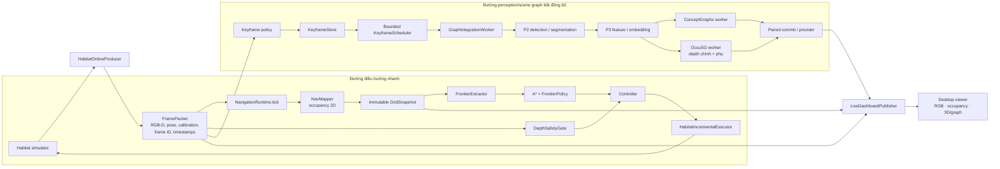

# Kiến trúc 3DSG

Tài liệu này mô tả **kiến trúc đang được triển khai trong repository**, tập trung vào đường chạy Habitat live với frontier exploration, graph workers và desktop viewer. Nó phân biệt rõ phần runtime đang dùng với các interface được chuẩn bị cho việc tích hợp ObjectNav về sau.

## 1. Mục tiêu và phạm vi

3DSG là một module cho bài toán ObjectNav lớn hơn. Runtime hiện tại cung cấp:

- Điều hướng hình học theo frontier trên occupancy map 2D của vùng đã quan sát.
- Xây dựng scene graph theo keyframe bằng các backend perception/mapping tùy chọn.
- Hiển thị RGB, occupancy map và graph/không gian 3D trong desktop viewer.
- Lưu frame identity, timestamp, calibration, hash, event journal và run artifacts để replay/audit.

Runtime **chưa phải một ObjectNav agent hoàn chỉnh**: navigation hiện chưa dùng semantic graph để chọn target object. API module ObjectNav đã có hợp đồng ban đầu, nhưng runner Habitat vẫn ráp trực tiếp các thành phần hiện hành.

## 2. Sơ đồ tổng thể

### Sơ đồ ASCII

```text
                                  +----------------------+
                                  | Habitat simulator    |
                                  | RGB-D / pose / events|
                                  +----------+-----------+
                                             |
                                  +----------v-----------+
                                  | FramePacket          |
                                  | frame ID / time /    |
                                  | calibration / depth  |
                                  +-----+-----------+----+
                                        |           |
                   ĐIỀU HƯỚNG NHANH    |           |    GRAPH BẤT ĐỒNG BỘ
                                        |           |
                            +-----------v--+   +----v-----------------+
                            | NavMapper    |   | Keyframe policy      |
                            | occupancy 2D |   | store + bounded queue|
                            +------+------+   +----------+-----------+
                                   |                     |
                            +------v-------+     +-------v-----------+
                            | GridSnapshot |     | Graph worker      |
                            +------+-------+     | P2 -> P3/features |
                                   |             +----+----------+---+
                            +------v-------+          |          |
                            | Frontier +   |      +---v----+ +---v----+
                            | A* + policy  |      |Concept | | OccuSG |
                            +------+-------+      |Graphs  | |+depth phụ
                                   |              +---+----+ +---+----+
                            +------v-------+          \        /
             depth mới ---> | Safety gate  |           \      /
                            | + Controller |            v    v
                            +------+-------+       +----+----+-----+
                                   |               | Paired provider |
                            +------v-------+       | graph snapshot  |
                            | Habitat      |       +--------+--------+
                            | action step  |                |
                            +------+-------+                |
                                   |                         |
                                   +-------> simulator       |
                                                             |
   RGB-D frame ----------------------+                       |
   GridSnapshot ---------------------+--> Live publisher <----+
                                           (files + hashes)
                                                  |
                                    +-------------v-------------+
                                    | Desktop: RGB / 2D grid /  |
                                    | 3D point cloud + graph    |
                                    +---------------------------+
```

### Sơ đồ Mermaid



Hai đường xử lý có tốc độ và mục đích khác nhau. Navigation cập nhật theo observation/tick và **không chờ graph worker**. Graph chỉ xử lý keyframe đã được admission; do đó graph có thể trễ hơn camera mà không trực tiếp làm thay đổi goal frontier.

## 3. Thành phần điều phối và dữ liệu đầu vào

### Entry points

- [`scripts/run_frontier_habitat.py`](../scripts/run_frontier_habitat.py): CLI runner chính; nạp scene/profile, khởi tạo Habitat, navigation runtime, tùy chọn P2/graph plugin, telemetry, live publisher và shutdown.
- [`scripts/run_desktop.py`](../scripts/run_desktop.py): mở giao diện desktop và điều khiển runner qua tiến trình riêng.
- [`configs/exploration/`](../configs/exploration/): scene config và profile runtime. Scene config mô tả simulator, camera, navmesh, spawn và calibration; profile đặt cadence, giới hạn motion, freshness, keyframe và resource limits.

### Frame và coordinate contracts

[`exploration/contracts.py`](../exploration/contracts.py) định nghĩa các giá trị đi qua các ranh giới:

- `FramePacket`: identity run/scene/frame, timestamps, RGB-D, camera calibration/pose và depth sensor tùy chọn.
- `GridSnapshot`: occupancy/evidence, revision, frame nguồn, origin và resolution; snapshot được dùng như dữ liệu nhất quán, không sửa trực tiếp sau khi publish.
- `PathResult`: đường đi kèm revision/scope của map nguồn.
- `ActionCommand`: lệnh chuyển động kèm frame và deadline freshness.

Các identity và thời gian này giúp đối chiếu frame giữa runner, worker, graph snapshot và viewer; chúng không tự chứng minh chất lượng ngữ nghĩa của kết quả.

## 4. Đường điều hướng nhanh

1. [`HabitatOnlineProducer`](../exploration/habitat_online.py) thu observation từ simulator, gắn RGB-D, pose, collision và frame identity.
2. [`NavMapper`](../exploration/nav_mapper.py) chiếu depth lên occupancy grid 2D. Cell chưa đủ floor/clearance evidence giữ trạng thái `UNKNOWN`; vùng chưa quan sát không được xem là traversable.
3. [`LatestMapWorker`](../exploration/map_worker.py) có thể tích hợp map bất đồng bộ. Queue bounded ưu tiên dữ liệu mới; snapshot chỉ được publish sau khi integration hoàn tất.
4. [`FrontierExtractor`](../exploration/frontier.py) tìm biên FREE/UNKNOWN và sinh viewpoint trong vùng đã quan sát được.
5. [`AStarPlanner`](../exploration/planner.py) tìm đường trên cell hợp lệ, áp dụng footprint inflation, corner-cut rule và blocked-edge overlay.
6. [`FrontierPolicy`](../exploration/policy.py) xếp hạng goal theo path cost, duy trì goal qua cập nhật map bằng hysteresis, và theo dõi goal đã tới/thất bại.
7. [`DepthSafetyGate`](../exploration/depth_safety.py) kiểm tra hành lang phía trước từ depth mới. [`Controller`](../exploration/controller.py) tạo lệnh vận tốc có giới hạn, theo path bằng lookahead, căn hướng hoặc dừng khi dữ liệu/path không an toàn.
8. [`HabitatIncrementalExecutor`](../exploration/habitat_factory.py) chuyển vận tốc liên tục thành bước simulator rời rạc, kiểm tra bước với NavMesh/collision filter và xác minh pose sau bước.

`NavigationRuntime` còn quản lý initial scan, recovery sau bước bị chặn, tiến độ, revalidation khi map đổi và stale-command gate ([`runtime.py`](../exploration/runtime.py)). Nếu map hoặc depth vượt deadline, lệnh chuyển sang dừng/chờ thay vì tiếp tục dùng dữ liệu cũ.

## 5. Đường perception và scene graph

Graph pipeline chạy theo keyframe, không theo mọi tick navigation:

1. Keyframe policy chọn frame theo chuyển động/độ xoay và giới hạn tốc độ graph.
2. [`KeyframeStore`](../exploration/keyframe_store.py) ghi dữ liệu cùng manifest/provenance; [`KeyframeScheduler`](../exploration/keyframe_scheduler.py) giới hạn queue và backpressure.
3. [`GraphIntegrationWorker`](../exploration/graph_bridge.py) đọc keyframe đã lưu, kiểm tra identity rồi gọi provider/plugin.
4. P2 detector/segmenter và P3 feature/embedding được gọi qua clients/workers. Các worker sống lâu dùng giao tiếp tiến trình cục bộ; OccuSG M2 có thể dùng binary transport khi được bật.
5. [`NativeConceptOccuGraphPlugin`](../exploration/native_graph_plugin.py) điều phối các nhánh ConceptGraphs và OccuSG, ghép kết quả theo frame identity/hash và quản lý provider snapshot.

### Ranh giới ConceptGraphs và OccuSG

- Đây là adapter/worker gọi **backend thật** từ các checkout và môi trường Python bên ngoài repo 3DSG; 3DSG không vendoring toàn bộ hai codebase.
- OccuSG nhận depth chính và depth phụ với calibration riêng.
- Paired dispatch/commit bảo đảm hai nhánh xử lý cùng packet/frame theo contract. Điều đó **không đồng nghĩa với semantic graph fusion** giữa ConceptGraphs và OccuSG.
- Snapshot native được publish cho viewer hiện dựa trên graph room/navigation bền vững từ OccuSG và observation object hiện thời; nhánh ConceptGraphs được lưu/đối chiếu riêng theo provenance. `graph_join_performed` không được xem là true chỉ vì hai worker cùng commit.
- Room membership và semantic accuracy cần annotation/evaluation độc lập; số node/room, hash hoặc frame parity không thay thế đánh giá đó.

Graph interfaces trung lập nằm tại [`scene_graph_provider.py`](../exploration/scene_graph_provider.py): provider công bố capabilities, nhận observation, trả snapshot có identity/revision/status/provenance. Đây là ranh giới thay backend graph mà không buộc navigation phải phụ thuộc vào ConceptGraphs hay OccuSG.

## 6. Live publisher và desktop

[`LiveDashboardPublisher`](../exploration/live_dashboard.py) ghi file-backed snapshots trong `runs/<run-id>/live/`. Các array RGB, depth, occupancy được gắn generation/hash trong state và publish theo cách atomically. Viewer poll các file, staging RGB-depth-map và chỉ đổi generation khi hash đồng khớp; graph được đọc riêng theo revision/as-of frame vì graph có thể chậm hơn camera.

[`exploration/desktop.py`](../exploration/desktop.py) hiển thị:

1. RGB frame hiện tại.
2. Top-down 2D occupancy map.
3. Khung 3D để quan sát không gian và scene graph.

Khung 3D tích lũy point cloud bằng cách backproject RGB-D ngay trong viewer, rồi vẽ node/edge graph lên trên. Point cloud này là **visualization do UI tạo**, không phải output point cloud của ConceptGraphs/OccuSG.

Khi khởi chạy desktop cần phân biệt demo plugin với native plugin: demo plugin tạo graph heuristic để xem UI; native adapter phải được chọn rõ trong runner để gọi ConceptGraphs/OccuSG thật. Các đối số CLI và mặc định được định nghĩa trong [`desktop.py`](../exploration/desktop.py) và [`run_frontier_habitat.py`](../scripts/run_frontier_habitat.py).

## 7. Worker, shutdown và khả năng tái lập

- Navigation map/planner workers có queue bounded và kết quả gắn revision/frame để loại hoặc rebase kết quả cũ.
- Graph scheduler giới hạn keyframe pending; graph worker xử lý tuần tự để giữ thứ tự và identity.
- [`EpisodeSupervisor`](../exploration/supervisor.py) quản lý budget và deadline shutdown. Runner đóng/cancel worker, gửi stop action và ghi lại frame pending cần replay.
- `runs/<run-id>/` lưu effective config, manifest, event journal, keyframe, summary và diagnostics. Scripts trong [`scripts/`](../scripts) dùng để replay packet/keyframe, audit freshness/graph, và đánh giá movement/resource.

> 3DSG không dùng ROS 2 làm bus runtime. Kết nối hiện tại là các Python API nội bộ, file artifacts và worker process/pipe cục bộ; adapter chịu trách nhiệm ánh xạ sang backend mapper.

## 8. Ranh giới mở rộng và phần chưa được nối

[`exploration/module_api.py`](../exploration/module_api.py) phác thảo `ObjectNavModule`, task, observation, navigation/perception/graph backends và `TargetSelector`. Mục đích là để sau này host benchmark hoặc ObjectNav cấp cao có thể gửi task và nhận command mà không gắn chặt vào Habitat.

Hiện tại:

- Runner Habitat vẫn trực tiếp khởi tạo mapper, planner, policy và controller; `ObjectNavModule` chưa phải runtime entry point đang được dùng.
- Graph provider/plugin là abstraction đang được dùng cho nhánh graph; thay đổi backend perception/mapping vẫn phụ thuộc worker adapter và môi trường backend.
- Navigation chọn frontier hình học, chưa query graph để chọn object target hoặc dùng relation graph để lập kế hoạch.
- ConceptGraphs và OccuSG chưa có cross-backend object identity/room fusion hoàn chỉnh.
- Mặc định map/policy là vùng single-level đã quan sát; chưa phải global semantic map toàn scene.

Các ranh giới này cho phép tiếp tục phát triển 3DSG như một module của ObjectNav: trước tiên ổn định host-facing lifecycle/ports, sau đó thêm target selector và fusion semantics mà không đưa inference/graph work vào vòng điều khiển an toàn.

## 9. Bản đồ source code

| Khu vực | Trách nhiệm |
| --- | --- |
| `exploration/contracts.py` | Frame/map/path/command data contracts |
| `exploration/nav_mapper.py`, `frontier.py`, `planner.py`, `policy.py`, `controller.py`, `runtime.py` | Navigation và safety |
| `exploration/map_worker.py`, `plan_worker.py` | Mapping/planning bất đồng bộ |
| `exploration/keyframe_*`, `graph_bridge.py`, `graph_plugins.py` | Admission, lưu trữ và tích hợp graph |
| `exploration/native_graph_plugin.py`, `native_*`, `p2_*` | Native perception/mapping adapters và transport |
| `exploration/live_dashboard.py`, `desktop.py`, `rgbd_object_graph.py` | Live publication, giao diện và graph demo |
| `exploration/module_api.py`, `scene_graph_provider.py` | Contracts mở rộng cho host ObjectNav và backend graph |
| `scripts/run_frontier_habitat.py`, `run_desktop.py` | Entrypoints |
| `scripts/audit_*`, `replay_*`, `evaluate_*` | Kiểm chứng artifacts, freshness và hành vi |
| `configs/exploration/` | Scene và runtime profiles |
| `tests/` | Regression cho contracts, planner, workers, viewer, transport và lifecycle |

Để theo dõi các gate và công việc còn lại, xem [`plan.md`](plan.md) và [`implementation_status.md`](implementation_status.md); tài liệu đó thay đổi theo kết quả run, còn file này mô tả ranh giới kiến trúc.
