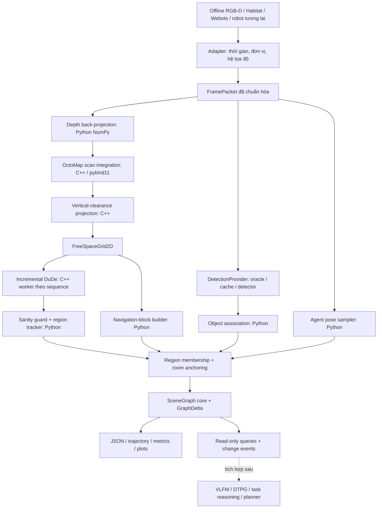

# Phase 1 — Audit OccuSG và thiết kế 3D Scene Graph độc lập ROS

Ngày audit: 24-09-2026. Trạng thái: tài liệu thiết kế để review, **chưa triển khai hệ thống**.

Mục tiêu: một package Python dùng cùng lõi dựng graph khi replay RGB-D trên Kaggle hoặc nhận frame trực tiếp từ Habitat/Webots. Giữ OctoMap, phép chiếu clearance và Incremental DuDe bằng C++ khi có thể; đưa association, room anchoring, graph và API về Python. Giới hạn thí nghiệm đầu: một tầng, môi trường tĩnh, pose biết trước; chưa gán nhãn ngữ nghĩa phòng, chưa có VLFM/DTPG/planner.

**Kết luận ngắn:** hướng standalone khả thi về cấu trúc phần mềm; không cần chuyển mọi thuật toán sang Python và không cần ROS ở runtime cuối. Tuy nhiên, chưa có bằng chứng native build/Kaggle/Webots end-to-end; DuDe/FIST có gate licensing/build. Paper và source khác nhau ở tracker, sanity guard và object association, nên phải khóa rõ baseline trước implementation.

**Cách đọc:** mục 2–5 là audit/thuật toán/tham số; 6–9 là kiến trúc/contracts/tọa độ/output; 10–12 là dependency/dataset/metrics; 13–16 là milestones/rủi ro/demo/lệnh dự kiến; 17–18 là bằng chứng đã chạy và khuyến nghị review. Mọi phần thiết kế mới đều có nhãn [D], không được coi là chi tiết của paper.

## 1. Phạm vi bằng chứng và quyết định chính

Ký hiệu sử dụng xuyên suốt:

- **[P]**: paper người dùng cung cấp, arXiv:2606.13727v1, 11-06-2026; §3.1–3.4, §4.1–4.6, Hình 1–2, Bảng I–III.
- **[C]**: mã nguồn OccuSG local tại commit `2bca2fa06af87fd9dd0542957039be8f580f0dca`; worktree sạch lúc audit.
- **[U]**: dependency/upstream, có commit hoặc URL riêng.
- **[D]**: quyết định kỹ thuật đề xuất cho đồ án; không được mô tả là kết quả của paper.
- **[?]**: chưa có bằng chứng chạy hoặc chưa giải quyết xong; cần milestone kiểm chứng.

Nguồn local OccuSG: `/home/kiettran05/Desktop/test_Room_segmentation/OccuSG`. Folder `Room-Segmentation-kaggle` trước đây là một codebase khác, nhận PLY và dùng watershed; không phải bản Python của OccuSG. Nó chỉ có thể dùng làm baseline ablation, không là backend reference.

Ba submodule chưa được khởi tạo trong repo local. Audit tải riêng đúng commit vào `research/occusg_phase1/upstream/`, không sửa repo gốc:

| Nguồn | Revision dùng để truy vết | Ý nghĩa |
|---|---|---|
| OccuSG | `2bca2fa06af87fd9dd0542957039be8f580f0dca` | Mốc reference-code; không khẳng định đây là commit tạo Bảng I của paper |
| Map conversion | `14b8cb9e6534ba21e84f624c94d20960f6613f3c` | Gitlink trong `.gitmodules`/tree của OccuSG |
| Octomap mapping | `7bb98eaa4235f9ca37bc388e242fce902209fc4e` | Gitlink trong OccuSG |
| YOLOs-CPP | `c790c8e315c40d3110a6602c2c41576b8e5770fc` | Gitlink trong OccuSG; trọng số model là artifact riêng |
| Incremental_DuDe_ROS upstream | `9500cab2e94a873935c6464703cfb9bd370dfa95` | Đọc wrapper và incremental algorithm gốc để đối chiếu |

**Quyết định [D]:** giữ hai mode cấp cao `reference` và `extended`. Vì paper và code không khớp hoàn toàn, `reference` cần trường `reference_target = code | paper`. Baseline có thể kiểm thử trực tiếp đầu tiên là `reference/code`; `reference/paper` là cách hiện thực đặc tả paper, không phải cam kết tái tạo được số liệu đã công bố.

Không đánh đồng ba mức chứng minh: đọc code; parity trên fixture; tái lập kết quả MP3D của tác giả. Phase 1 chủ yếu đạt mức đầu. Chưa chạy pipeline ROS, chưa biên dịch bridge mới, chưa chạy Kaggle/Webots; các lệnh ở cuối tài liệu là giao diện dự kiến.

## 2. Source-audit table

Trong bảng, đường dẫn `src/...` tương đối với OccuSG; `MC/...` với submodule mapconversion; `OM/...` với submodule octomap_mapping; `DU/...` với `src/incremental_dude_ros2/incremental_dude_ros2`. Liên kết mốc mã nguồn: [OccuSG](https://github.com/crcz25/OccuSG/tree/2bca2fa06af87fd9dd0542957039be8f580f0dca), [MC](https://github.com/crcz25/Map-Conversion-3D-Voxel-Map-to-2D-Occupancy-Map/tree/14b8cb9e6534ba21e84f624c94d20960f6613f3c), [OM](https://github.com/crcz25/octomap_mapping/tree/7bb98eaa4235f9ca37bc388e242fce902209fc4e), [DuDe upstream](https://github.com/lfermin77/Incremental_DuDe_ROS/tree/9500cab2e94a873935c6464703cfb9bd370dfa95).

| ID / concept | Paper | File / symbol đã truy vết | Phụ thuộc ROS? | Có thể dùng lại? / chiến lược standalone | Độ chắc chắn |
|---|---|---|---|---|---|
| S01 Depth → cloud | §3.2 | `src/point_cloud_generator/point_cloud_generator/depth_to_pointcloud_node.py:526,555,608`; `_decode_depth_image`, `_ensure_projection_cache`, `_depth_to_pointcloud` | Node, Image, CameraInfo, PointCloud2, sync có | Port kernel NumPy; bỏ message/TF/QoS; giữ stride, lọc depth và thứ tự pixel | Cao ở công thức; parity số cần test |
| S02 3D occupancy | §3.2 | `OM/octomap_server/src/octomap_server.cpp:781`, `OctomapServer::insertScan`; sensor model:413–486 | Lớp server có; liboctomap không | Wrapper C++ giữ OcTree và scan KeySet, raycasting, hit/miss; bỏ server/PCL transport | Cao; không giả định gọi `insertPointCloud` tự động giống `insertScan` |
| S03 Phép chiếu | §3.2, Hình 2 | `MC/mapconversion/src/MapConverter.cpp:20`; `HeightRangeMap.hh:29,45,84`; `Map2D.hh` | Các lớp này không cần ROS | Dùng lại C++, bọc cùng native occupancy bridge | Cao; cách xử lý biên/unknown phải giữ trong reference |
| S04 Cập nhật projection cục bộ | §3.2 mô tả tổng quát | `MC/mapconversion/src/map_conversion_oct_node.cpp:442,520,566`; `computeBoundingBox`, `update2Dmap`, `pub` | Callback/publish có | Trích logic duyệt leaf, changed bounds và xuất `/mapUAV`; thay msg bằng array | Cao về đường chạy; parity full-vs-partial chưa đo |
| S05 Chuẩn bị ảnh DuDe | §3.3 | `DU/src/inc_dude.cpp:450,1137`; `mapCallback`, `clean_image2` | Callback có; OpenCV kernel không | Trích kernel C++, không thay bằng morphology mới | Cao; bộ lọc không phải median dù tên biến gợi ý vậy |
| S06 Incremental decomposition | §3.3; dependency [10] | `DU/include/inc_decomp.cpp:455`, `Incremental_Decomposer::decompose_image`; upstream cùng symbol:35 | Logging ROS trong bản OccuSG; không phải bản chất thuật toán | Giữ stateful C++, thay logger bằng facade; giữ các nhánh fallback có ghi provenance | Cao về call path; shrink/holes/crash cần fixtures |
| S07 Dual-Space Decomposition | §3.3 dẫn [10] | `DU/include/wrapper.cpp:158,318`; `DuDe_OpenCV_wrapper::Decomposer`, `Dual_decompose`; `Third_Party/dude_final/src/dude.cpp:108`, `c_dude::build`; `cdt2.cpp`; `dude_use.cpp` | Lõi gốc không ROS; bản bundled có macro logging | Dùng lại kernel và bản vá OccuSG; executable C++ đầu tiên; không viết lại DuDe | Cao về thuật toán gọi; FIST/licensing là gate |
| S08 Region adjacency/raw geometry | §3.3 | `DU/src/inc_dude.cpp:739`, `build_raw_region_message`; `inc_decomp.cpp:892`, `are_contours_connected`; `region_geometry_utils.hpp:42` | Chuyển message có | Port converter/adjacency hoặc đưa vào CLI; polygon vertex convention giữ rõ | Cao; adjacency là vertex proximity, không phải detector cửa |
| S09 Region tracking | §3.3 | `DU/include/basic_region_tracker.hpp:66,252,297,336`; `canonicalize`, `bboxIoU`, `scoreCandidate` | Kiểu Region2D ROS | Port Python đúng score, gates, thứ tự tie và miss lifetime | Cao; khác paper đáng kể |
| S10 Sanity/rejection | §3.3 | `DU/src/inc_dude.cpp:890,984`, `validate_region_update`, `reject_region_update`; YAML:16–17 | Publish/clock có | Policy Python; C++ phải hỗ trợ propose/accept/reject hoặc checkpoint trạng thái | Cao; YAML cho phép giảm 85%, không phải 15% |
| S11 Perception | §3.2 | `src/semantic_perception/src/semantic_node.cpp:887–1200`; mask/depth, PCL Euclidean clustering, AABB, TF | Node/TF có; YOLO/PCL không | Provider độc lập; oracle trước; adapter detector + masked-cloud geometry sau | Cao về call path; model exact parity chưa có trọng số/hash |
| S12 Object association | §3.4 | `src/scene_graph_ros/scene_graph_ros/managers/object_manager.py:376,541` | ROS detection/Pose/TF | Port `_find_or_add`, normalized label, nearest key; strategy interface | Cao; thêm same-pose suppression và không fusion centroid |
| S13 Agent layer | §3.4 | `.../managers/pose_manager.py:258`, `process_odometry_update` | Odometry/Time | Port sampler, timestamp, temporal edges; trajectory log lưu mọi frame riêng | Cao; pose camera khác pose base phải khai báo |
| S14 Navigation layer | §3.4 | `.../managers/free_space_manager.py:525,607,748,920,989` | Grid/Time | Port NumPy block counting + BFS trong hai block; world-anchored keys | Cao; node center có thể không nằm trên free cell |
| S15 Membership | §3.4 | `.../managers/region_manager.py:206,278,345,455,533`; `region_util.py` | Region messages | Dùng Shapely; giữ tie-break riêng cho point và nav footprint | Cao; không chỉ `centroid in mask` |
| S16 Room anchoring | §3.3 | `.../scene_graph_region.py:1032,1092,1136,1370`; `room_manager.py:231,822,1183,1642` | Orchestrator/timer có | Port room ownership, materialization, relink/prune, adjacency; scheduler timestamp | Cao; helper legacy không phải mọi helper đều chạy |
| S17 Core graph | §3.1 | `src/scene_graph_core/scene_graph_core/representation/{geometry,node,edge,graph}.py`; `services/{query_service,update_service,graph_patch}.py` | Core import không ROS; packaging còn ament metadata | Tái sử dụng core/API/query/GraphPatch qua facade, không tạo engine graph thứ hai | Cao từ source; kiểm thử standalone riêng |
| S18 JSON | Paper không đặc tả schema | `src/scene_graph_core/scene_graph_core/serialization/json_serializer.py:55`; `graph_interface/serialization.py`; ROS `json_export.py:57` | Serializer không; shutdown trigger có | Giữ deterministic/atomic export; thêm schema standalone + importer và tracked state | Cao; exporter mới không tự bảo đảm importer cũ roundtrip |
| S19 MP3D regions | §4.1–4.2 | `src/scene_graph_ros/scripts/evaluate_mp3d_regions.py:678,831,854,902,952,1028,2052` | Không | Tách dataset parser và metric kernel; dùng lại Hungarian/IoU/bF1/overlap diagnostics | Cao; GT có fallback hull, alignment rộng hơn paper |
| S20 MP3D objects | Không phải bảng room chính | `.../scripts/evaluate_mp3d_objects.py:293,397,642` | Không | Tái sử dụng class-aware matching, percent_found/correct, centroid error | Cao; percent_correct là precision, không phải object-room accuracy |
| S21 Profiling/evaluation batch | §4.6, Bảng III | `.../profiling.py`; `aggregate_runtime_profiles.py:173,259`; `collect_mp3d_eval_tables.py`; `run_all_region_evals.sh`; `DU/src/evaluation.cpp` | Recorder một phần không; DU evaluation ROS GUI có | Giữ tên stage/CSV; thêm per-update trace; thay batch shell hard-coded paths | Cao; total std cũ là tổng std, không phải std end-to-end |

## 3. Những khác biệt phải ghi trong báo cáo nghiên cứu

### 3.1 Tracker: paper khác code

[P] §3.3 mô tả IoU lớn nhất, đồng thời IoU > 0,20, dịch centroid < 1,5 m và area ratio trong [0,25; 4].

[C] S09 tính **bounding-box IoU**, lấy bounds từ convex hull khi có, không tính polygon IoU. Gate thực tế:

```text
area_ok AND (bbox_iou >= 0.20 OR centroid_distance <= 1.5)
score = 2*bbox_iou + max(0, 1-distance/max_distance)
        + 0.25*min(area_ratio, 1/area_ratio)
```

Sắp candidate giảm dần score, rồi IoU, tăng dần distance, canonical ID và current index; ghép greedy một-một. Không dùng Hungarian trong tracker. `Config` C++ mặc định distance=1,0 m nhưng launch YAML là 1,5 m. Runtime profile phải khóa giá trị hiệu lực, không lấy default class thay YAML.

[D] `reference/code` giữ chính xác cách này. `reference/paper` dùng polygon IoU và AND gates; thuật toán giải xung đột một-một khi paper không đủ chi tiết phải ghi là lựa chọn hiện thực. Hungarian và split/merge-aware tracker thuộc `extended`.

### 3.2 Guard: 15% trong paper, 85% trong code

[C] S10/YAML đặt `max_region_area_drop_ratio = max_region_count_drop_ratio = 0.85`. Biểu thức reject là `current/previous < 1 - max_drop_ratio`. Do đó reject khi **còn dưới 15%**, tức giảm **hơn 85%**. [P] nói giảm hơn 15%.

Hơn nữa, code cộng **diện tích các polygon đầu ra**, không dùng trực tiếp tổng số free cell của input. Các gate bổ sung: số region tối thiểu 1; unknown ratio >0,98 sau khi đã có state hợp lệ; zero-regions sau state hợp lệ. Lần đầu chỉ kiểm tra minimum count. Threshold bằng đúng ranh giới phải có test riêng.

[D] Đặt tên config mới không mơ hồ: `max_relative_area_drop` và `max_relative_count_drop`. Giá trị reference-code=0,85; paper profile=0,15. Lưu cả input free area và output polygon area trong diagnostic. Sửa thành 0,15 rồi gọi là cùng baseline code là sai.

### 3.3 Missing track không đồng nghĩa room được bảo tồn ba update

[C] Tracker lưu missed track trong bộ nhớ và xóa khi `missed_frames > 3`, tức ở miss thứ tư. Nhưng output `result.message` chỉ chứa region quan sát ở frame hiện tại; missed polygons không được thêm vào message. Room maintenance prune những anchor không nằm trong snapshot hợp lệ hiện tại sau khi thử relink. Vì vậy, room có thể bị prune trước khi tracker hết miss buffer. Empty-message guard giữ snapshot cũ; một snapshot không rỗng nhưng mất riêng một region vẫn có thể làm room đó mất.

[D] Reference-code phải phân biệt `tracker_active_memory` và `published_current_regions`. Extended mới bảo tồn room theo track `temporarily_missing`. Chỉ gọi đây là cải tiến khi ablation chứng minh được lợi ích.

### 3.4 Object: không chỉ same-class + 0,75 m

[C] S12 ưu tiên nearest same-class trong bán kính merge. Nếu không có, vẫn tái dùng nearest object trong `min(merge_radius, 0.15 m)` kể cả khác class hoặc thiếu label. Điều này khác [P] rằng unlabeled detections luôn tách biệt. Khi match, code cập nhật `last_seen` và metadata ID; **không tính running weighted centroid, không cập nhật aggregate confidence**. Tọa độ/score hiện hữu không tự fusion theo frame mới.

[C] S11 cũng không dùng centroid trung bình point cloud: nó chọn cluster PCL lớn nhất và lấy **tâm AABB trong camera frame**, sau đó transform ra world. Hai khái niệm này phải tách ở `Detection3D.center_method`.

[D] Reference-code giữ first-observation geometry và same-pose suppression. Reference-paper bỏ suppression khác class. Multi-view confirmation, covariance, weighted centroid/confidence là extended theo architecture của bạn.

### 3.5 Clearance: structural free space không bảo đảm robot mặt đất đi được

[P] Hình 2 cho phép một cột có khoảng trống phía trên đồ nội thất thấp. [C] S03 giữ khoảng `top-bottom > minimum_z`; các interval có epsilon `resolution*0.001` ở mỗi đầu. Không phải cứ “sáu voxel ở 0,05 m” là cách kiểm tra ngưỡng chính xác vì epsilon và strict comparison ảnh hưởng biên.

Code còn phân biệt `-1` unknown và occupation 0–100; một cột thiếu free run không luôn được đặt occupied ngay. Occupation được suy ra tại lân cận free columns. `/mapUAV` không áp slope gate của `/mapUGV`.

[D] Public API đặt tên rõ `kind="structural_clearance"`; planner về sau dùng thêm `TraversabilityGrid2D` theo footprint, chiều cao, collision và clearance tại mặt sàn. Không sửa projection tham chiếu để làm thay nhiệm vụ planner.

### 3.6 Incremental DuDe có state và các nhánh thay thế

[C/U] Incremental không có nghĩa chạy DuDe từ đầu rồi chỉ ghép ID. Nó rasterize các region trước, lấy phần free mới ngoài footprint trước, nối với region cũ bị ảnh hưởng, phân rã phần mở rộng và giữ region không liên quan. Nó thiên về map tăng trưởng; shrink/removal không đối xứng với expansion.

[C] Bản OccuSG có kiểm tra polygon, global-decoration cleanup, `fork/pipe/waitpid` để cô lập DuDe crash, full-decomposition fallback, giữ state cũ, và một số nhánh dùng free contours khi không có decomposition hợp lệ. **Nhánh free-contour fallback không phải kết quả DuDe thành công.** Phải ghi `algorithm_status`, `last_branch`, `fallback_used` mỗi update. Raw polygons cũng không có persistent identity trước S09.

[D] Không fork tùy tiện trực tiếp bên trong Python đa luồng. Worker executable C++ do Python sở hữu sẽ giữ incremental state; phần DuDe con được cô lập theo cơ chế upstream. Không mở network service/daemon. Khi kết thúc sequence, đóng worker. Nếu sau này dùng pybind11 cho DuDe, cần xử lý reentrancy, global state và crash thay vì chỉ tối ưu IPC.

### 3.7 Lõi graph đã là Python không ROS

[C] `scene_graph_core` dùng dataclasses, NetworkX, NumPy/SciPy và own Pose. Package vẫn có ament index resource nhưng không có ROS import bắt buộc trong các module lõi đã kiểm tra. Không cần viết lại graph storage từ đầu. `REGION` tồn tại trong enum để compatibility; active region pipeline giữ tracked regions ngoài graph và dựng bốn lớp chính. Các hàm legacy dựng room footprint từ nav union có trong file nhưng không phải đường maintenance active đã truy vết.

[C] Z offsets 4/8/12 m phục vụ hiển thị tầng graph xuất hiện trong node pose. [D] Standalone phải tách `geometry_world` và `display_layout`; không dùng z hiển thị làm vị trí robot/object hoặc khoảng cách 3D. Parity adapter có thể xuất layout kiểu cũ cho kiểm tra.

### 3.8 Multi-view trong architecture cũ

File architecture đặt `viewpoint_is_independent` vào điều kiện same-object. [D] Cần tách hai bước: association vẫn có thể nhận cùng object từ góc nhìn cũ; **chỉ evidence counter** không tăng khi viewpoint không độc lập. Nếu gate association bằng viewpoint, frame liên tiếp rất dễ sinh candidate trùng. Đây là điều chỉnh đề xuất đối với ghi chú của bạn, không lấy từ OccuSG.

## 4. Thuật toán cần giữ và ranh giới C++/Python

### 4.1 Geometric mapping

[C/D] Với optical camera `x right, y down, z forward`, axial depth d:

```text
p_C = [(u-cx)*d/fx, (v-cy)*d/fy, d]
p_W = T_W_C * [p_C, 1]
sensor_origin_W = translation(T_W_C)
```

Đầu vào `uint16` không tự hiểu là mm: adapter đọc `meters_per_unit`. Invalid mask loại zero, âm, NaN, Inf theo sensor contract. Không coi no-return vô hạn là hit ở max range. Nếu backend hỗ trợ free-only rays, phải có `has_hit=false` và max range tường minh. Depth max 10 m trong point generator và ray integration max 8 m là hai tầng lọc khác nhau.

[C] `insertScan` gom `free_keys`, `occupied_keys` cho **toàn bộ scan**; occupied thắng free trong cùng scan; mỗi key được update một lần cho loại tương ứng. Điểm ngoài max range tạo free-only ray đến 8 m, gồm endpoint cắt. OctoMap cập nhật log odds hit/miss và clamping. Update từng pixel trực tiếp không tương đương do đếm lặp evidence. Lõi cần test cả thứ tự điểm và điểm trùng.

[D] Giữ state OcTree và projection trong native C++ worker để đọc OcTree trực tiếp, không serialize cây mỗi frame. M2 đã dùng persistent C++ worker. M3 reference/runtime backend ưu tiên compile/link trực tiếp `MapConverter.cpp`, `HeightRangeMap.hh`, `Map2D.hh` và `datatypes.hh` từ checkout đã pin với Eigen; bỏ ROS transport khỏi target. C++ harness gọi source trực tiếp là parity oracle. `src/standalone_sg/mapping/projection.py` là Python debug port phục vụ fixtures/diagnostics, không thay source C++ làm reference backend. pybind11 là tùy chọn; cùng-process C++ worker đã phù hợp với OcTree stateful.

### 4.2 Phép chiếu đúng nguồn

[C] Trích `MapConverter`, `Map2D`, `HeightRangeMap`, `datatypes`:

1. Duyệt leaf có cả free và occupied, giữ center, half-size, state; leaf có kích thước lớn cần trải lên các XY cells nó bao phủ.
2. Mỗi cell tích lũy các interval Z. Free và occupied được hợp nhất trong hai danh sách riêng khi chồng nhau. Unknown không biến thành free interval.
3. Mở interval một lượng `resolution*0.001`; bỏ free intervals có chiều dài không vượt `minZ`.
4. Cell có interval sống sót nhận giá trị 0; lưu bottom thấp và top cao theo code. Cell không có interval có thể còn -1.
5. Quanh cell free, occupation của cột hàng xóm so với free-height interval được tính từ tỷ lệ overlap occupied, nhân 2, clamp 100; dưới `minimum_occupancy=5` trả -1. Giữ thứ tự và vùng biên vòng lặp.
6. Map2D lưu dạng submap 128 cells, mở rộng theo world offset. Xuất occupancy row-major; `/mapUAV` lấy giá trị không slope-filter. Height/slope hữu ích diagnostic nhưng chưa là graph node.

Không thay bằng “lấy z cao nhất”, chiếu mọi hit xuống XY, hoặc nối khoảng unknown giữa hai quan sát. Bridge phải nhận/đọc native tree trực tiếp. Reference-code giữ partial-update path, ghi bounds và halo; full-refresh là chế độ kiểm tra để phát hiện khác biệt, chưa gọi là tương đương trước test. Đổi origin/resolution giữa updates là trường hợp bắt buộc trong fixtures.

### 4.3 DuDe và cách gọi

[C/U] `Decomposer` dùng OpenCV `RETR_TREE`, xác định outer contour lớn nhất trong ảnh component, thêm các hole đủ diện tích, kiểm tra orientation, chuyển sang `c_polygon`. `c_dude::build` xây bridge/pocket concavity, thu feature points, simplified/reduced polygons, constrained Delaunay candidates bằng CGAL, chọn cutsets và xử lý cuts giao nhau; `iterativeDecompose` áp cuts để lấy polygon pieces. Giữ nguyên thuật toán này.

| Cách bridge | Điểm mạnh | Hạn chế | Quyết định [D] |
|---|---|---|---|
| Executable C++ + stdin/stdout | Tránh Python ABI và non-PIC static archive; crash không giết Python; tái lập bằng replay | Cần protocol, timeout, giữ state đúng | **DuDe v1**: một subprocess có lifetime theo sequence, không start fresh mỗi frame |
| pybind11 | State/native arrays thuận tiện, overhead thấp | FIST non-PIC, global state, SIGSEGV và Python ABI | **OctoMap/projection v1**; DuDe hoãn đến khi benchmark cần |
| ctypes/cffi | ABI C ổn định | Phải thiết kế opaque handles, allocation/free polygon arrays, exception boundary; vẫn gặp non-PIC | Không chọn v1 vì thêm việc mà không loại rủi ro lớn nhất |

DuDe CLI handshake trả version, upstream SHA, compiler/library versions và config hash. Mỗi request có `seq`, timestamp, shape, resolution, integer cell origin, byte count và occupancy/binary payload; stdout chỉ protocol, logs sang stderr. Response có polygons, raw adjacency, status và token trạng thái. Giới hạn payload/timeouts đều nằm trong config. Dùng length-prefixed metadata + raw uint8 buffer; CLI batch-debug có thể đọc `.pgm + grid.json`, xuất `.json`. Không dùng pickle.

Worker giữ `Incremental_Decomposer`. Guard chạy bên Python trước canonicalization. `propose → accept/reject` phải có rollback rõ ràng; code nguồn chỉ restore `Stable` trong nhánh reject, không chứng minh restore mọi cache. Reference-code mô phỏng đúng legacy state, extended dùng snapshot đầy đủ/transaction an toàn. State sau reject, origin shift, wrapper crash và worker restart đều là acceptance tests. Restart cần khôi phục checkpoint hoặc replay prefix; không reset rồi giả vờ ID vẫn liên tục.

### 4.4 Danh sách reuse/port/rewrite/discard

| Loại | Thành phần |
|---|---|
| Giữ nguyên upstream C/C++ nếu licensing cho phép | liboctomap; kernel DuDe/CGAL/FIST từ bản đã pin, giữ patches OccuSG; không đổi thuật toán cuts |
| Bọc/trích nhỏ | OctoMap scan integration, MapConverter/HeightRangeMap/Map2D, Incremental_Decomposer/OpenCV wrapper; thay ROS logger, thêm bridge/config hooks |
| Dùng lại Python | `scene_graph_core` representations, queries, update service, GraphPatch, deterministic serializer; standalone evaluation/profiling kernels sau kiểm thử |
| Port sang Python | BasicRegionTracker và guard; agent sampler; object policy; nav block manager; region membership; room anchoring/relink/prune/adjacency; scheduler |
| Viết mới trong Phase 2 | Typed contracts/facade, simulator adapters, offline manifest, GraphDelta, checkpoint schema, metric adapter, benchmark runner, visualization, fixture tests |
| Bỏ khỏi runtime | rclpy/rclcpp, ROS messages, TF2 transport, topics/QoS, rosbag player, launch files, RViz, marker publishers, Docker-only environment, path hard-coded của tác giả |
| Hoãn | GPU detector parity, advanced association, room naming, multi-floor, VLFM, DTPG, exploration/planner, web frontend |

“Giữ nguyên” không cho phép chép mù toàn bộ Third_Party: cần xác nhận license, lọc binary/demo/GUI và tạo patch ledger. Các thay đổi kiểu parameterize literal phải có default tương đương và golden test. Mathematical constants không phải tuning knobs; mọi threshold thuật toán, tolerance hình học và scheduler phải được đăng ký cấu hình.

## 5. Bảng xác minh tham số

Nguồn **Y**: `src/scene_graph_ros/config/scene_graph_pipeline_params_mp3d.yaml`; **D-Y**: `DU/config/inc_dude_params.yaml`. Đây là profile MP3D, không phải mọi cấu hình robot.

| Tham số | Nguồn chính xác | Ý nghĩa / đơn vị / nơi áp dụng | Paper-code | Giữ thế nào |
|---|---|---|---|---|
| 0,05 | [P] §3.2; Y:69 | OctoMap resolution, m/leaf nhỏ nhất | Khớp | Reference giữ |
| 8,0 | [P] §3.2; Y:75; OM `insertScan`:819–846 | Max Euclidean ray integration range, m | Khớp | Giữ; không đồng nhất depth clip |
| 0,3 | [P] §3.2; Y:83; `HeightRangeMap.hh:45` | Minimum free Z interval, m; code giữ `>`, với epsilon | Giá trị khớp; biên khác ký hiệu ≥ paper | Reference-code giữ strict/epsilon |
| 0,20 | [P] §3.3; D-Y:6; `basic_region_tracker.hpp:316–331` | Bbox IoU gate, unitless | Paper polygon/AND; code bbox/OR | Hai profile riêng |
| 1,5 | [P] §3.3; D-Y:7; tracker:320 | Centroid XY displacement, m | Giá trị khớp; điều kiện khác | Giữ runtime value; không lấy class default 1,0 |
| [0,25; 4] | [P] §3.3; D-Y:8–9; tracker:312–315 | Area current/previous, inclusive | Khớp giá trị | Giữ |
| 3 | [P] §3.3; D-Y:10; tracker:159–160 | Số update tracker miss được giữ; xóa khi >3 | Buffer khớp; output/membership không giữ toàn bộ | Ghi rõ missed visibility |
| 15% vs 85% | [P] §3.3; D-Y:16–17; `inc_dude.cpp:931–946` | Drop tổng polygon area/count | **Không khớp** | reference-code max drop .85; paper .15 |
| 0,75 | [P] §3.4; Y:136; object manager:541 | 3D radius cho same-class association, m | Chưa đủ mô tả code | Giữ và ghi suppression .15 m |
| 15×15 | [P] §3.4; Y:143; free-space manager:627 | Block ở grid world-anchored; cạnh .75 m tại res .05 | Khớp | Giữ units cells, không đổi resolution ngầm |
| 25 | [P] §3.4; Y:144; nav manager:755 | Số `grid == 0` tối thiểu để tạo node | Khớp tạo mới; existing node có thể giữ dưới ngưỡng | Giữ + trạng thái qualifies |
| 8 | [P] §3.4; Y:146; nav manager:900,920 | Neighbor offsets block/cell + connected-free-path | Paper ngắn hơn code | Giữ BFS trong union hai block |
| 0,5 Hz | [P] §3.3; Y:126; orchestrator:1370 | Maintenance mỗi 2 s, không phải mỗi .5 s | Khớp | Replay theo timestamp, không wall clock |
| 0,5 | [P] §3.4; Y:140; region manager:533 | Polygon boundary tolerance, m | Khớp giá trị; ties có policy | Giữ và log boundary assignments |
| 1,5 | [P] §4.5; D-Y:3; `inc_dude.cpp:520` | DuDe concavity threshold m; đổi sang pixels `tau/res` | Khớp | Giữ; không phải kích thước cửa |
| 0,7/.4/.12/.97 | [U/C] OM:413,422,431,440 | hit/miss/clamp probabilities | Paper không nêu | Reference lấy server defaults đã kiểm chứng |
| 5 | [U/C] Y:86; `HeightRangeMap.hh:95` | Minimum occupation score của projection, không phải số voxel | Paper không nêu | Giữ |
| .001×res | [C] `MapConverter.cpp:84–85` | Interval overlap padding, m | Không nêu | Đưa vào config native |
| 2, 10; dilate 4/1 | [C] `inc_dude.cpp:1141–1151` | Box-filter sizes px; obstacle/free dilation iterations | Không nêu | Giữ dtype uint8 và saturation trong reference |
| .5 | [C] `inc_decomp.cpp:440,502` | Safety distance m → gap → min contour area gap² px² | Không nêu | Config riêng, không nhầm clearance Z |
| 2 | [C] `inc_decomp.cpp:896` | Contour adjacency distance **<2 pixels** | Không nêu | Giữ pixel unit |
| .65/.5/.15 | [C] room manager:822–829 | Relink min old-overlap/member support/score margin | Paper không nêu số | Giữ trong reference-code |
| .75; .45/.35/.10/.10 | [C] room manager:1062–1081 | Member support khi centroid ngoài; score weights | Không nêu | Config relink policy |
| .15 | [C] object manager:566 | Cross-class/unknown same-pose suppression cap, m | Khác paper | Code on; paper off |
| .70/.45; .05; 50 | [C] Y:43–46; semantic node:1068–1070 | Detection confidence/NMS IoU; cluster eps m; min points | Paper không đủ chi tiết | Chỉ real-provider profile |
| .5 m / 10 s | [C] Y:132–133; pose manager:258 | Agent pose sampling thresholds OR | Paper không nêu số | Giữ; full trajectory log độc lập |
| .15/.25/.10/.10 | [P/C] §4.2; region evaluator:1911–1914 | Match IoU; boundary tolerance m; sample spacing m; overlap area m² | Ba đầu khớp; cuối code-only | Khóa evaluation config |
| 1,0 | [C] object evaluator:771 | Object matching distance m | Không phải merge threshold .75 | Khóa evaluation config |

[D] Config loader dùng dataclasses có validation + YAML/JSON. Reject key không biết; không silently clamp input sai. Khi cố ý mô phỏng clamp upstream, lưu cả requested và effective. `resolved_config.json` chứa mode/target, source commit, native versions và toàn bộ thresholds; SHA-256 canonical JSON là config hash. Các literal chưa liệt kê trong bảng nhưng gặp khi extraction phải vào `parameter_registry` trước nghiệm thu module. Không hứa mọi constant bên trong CGAL được biến thành tham số; giữ library pin và phân biệt constant toán học với quyết định tunable.

## 6. Kiến trúc standalone và chu kỳ cập nhật

Sơ đồ [D]; các nhánh vào giữa pipeline là các chế độ input hợp lệ, không bắt mọi nguồn phải cung cấp RGB-D.



Các dependency truyền qua constructor. `SceneGraphBuilder` chỉ biết protocol `OccupancyBackend`, `ProjectionBackend`, `RegionSegmenter`, `RegionTracker`, `DetectionProvider`, `ObjectAssociationPolicy`, `GraphStore`; không import `habitat_sim`, `controller`, YOLO, ROS hoặc kiểu dữ liệu nội bộ DuDe.

### 6.1 Input mode và tránh tích hợp trùng

| Mode | Nguồn bắt buộc | Stage chạy / bỏ qua |
|---|---|---|
| `rgbd` | RGB/depth nếu cần semantics; K; sensor pose; base pose cho agent | Back-project → occupancy → projection → segment → graph |
| `pointcloud` | World points, từng ray origin/scan origin, hit validity, pose | Bỏ back-project; phù hợp 3D LiDAR hoặc cloud từ bên ngoài |
| `occupancy` | Versioned native snapshot/update, pose | Bỏ integration; chạy projection và phần sau |
| `grid` | Canonical structural grid, pose | Bỏ occupancy/projection; dùng test segment/tracker/graph |
| `regions` | Region observations + grid nếu muốn nav, pose | Bỏ geometric segmentation; dùng test tracker/anchoring |

[D] Mỗi stage chọn **đúng một authoritative input** trong config. Nếu packet mang cả depth và grid thì grid có thể là diagnostic, nhưng không tự động chạy hai nhánh rồi ghi đè nhau. Detection rỗng `[]` nghĩa là provider đã chạy và không thấy object; `None` nghĩa là không có quan sát semantics. Không dùng `None` làm evidence phủ định.

Một 2D LiDAR scan ở một độ cao **không đủ dữ liệu để tái tạo clearance theo cột Z** giống RGB-D/3D LiDAR. Adapter 2D LiDAR có thể cấp occupancy grid cho một baseline 2D, nhưng không được gọi là cùng projection OccuSG. Hợp nhất RGB-D + LiDAR cần cùng world frame, timestamp/extrinsics và chính sách tránh đếm lặp scan; chưa cần cho MVP.

### 6.2 Transaction và scheduler [D]

V1 dùng một update loop đồng bộ, single writer; không queue broker. Các bước:

1. Validate packet, scene/sequence ID, frame ID tăng dần, clock và transforms; ghi full trajectory.
2. Theo lịch timestamp: chuẩn hóa cloud, integrate, project khi tới kỳ; chạy semantics nếu provider chưa có kết quả.
3. Khi có grid version mới: propose DuDe update → sanity decision → canonical tracking. Update bị reject không được tính là “sensor đã không thấy region”; giữ provenance của segmentation cũ.
4. Cập nhật agent/object/nav; gán region membership; chạy room maintenance theo thời gian mô phỏng (reference 2 s), bootstrap riêng.
5. Kiểm tra invariants; commit GraphPatch nguyên tử; trả GraphDelta với graph revision mới, dirty IDs, diagnostic và stage versions.
6. Cuối sequence `flush()` xử lý pending observations và maintenance theo chính sách terminal xác định; export ghi rõ snapshot trước/sau flush. `close()` đóng native worker.

Không lặp maintenance hàng nghìn lần khi timestamp nhảy: policy catch-up có cấu hình và log. `snapshot()` trả immutable/deep-copy view. Reader không được sửa trực tiếp NetworkX nội bộ. Nếu lỗi DuDe có thể tiếp tục ghi trajectory/object với `regions_stale=true`; graph delta phải báo phần bị stale. Không âm thầm coi state cũ là quan sát mới.

Reproducibility gồm seed, frame order, fixed timestamps, config/native/library versions, model hashes, input checksums. Floating-point tolerance tách khỏi exact ID/event comparisons. Không hứa bitwise parity giữa mọi compiler nếu chưa kiểm chứng.

## 7. Data contracts và public API [D]

Mọi timestamp là giây `float64` theo sequence clock; length m; angle rad; ID string ổn định trong namespace `(scene_id, sequence_id)`. Array contiguous NumPy, validation ở public boundary. Không dùng ROS message, TF tree hoặc simulator handles trong snapshot.

### 7.1 Cảm biến và hình học

| Contract | Fields tối thiểu và invariant |
|---|---|
| `CameraIntrinsics` | `width,height:int`, `fx,fy,cx,cy:float`, `model="pinhole"`, distortion và calibration ID; fx/fy>0. Distorted input phải rectified hoặc bị reject; resize/crop cập nhật K |
| `Transform` / `Pose` | `T_parent_child:float64[4,4]`, parent/child frame IDs, timestamp, `source={ground_truth,slam,odometry}`, optional 6×6 covariance; proper rotation det≈+1, last row [0,0,0,1]. JSON quaternion quy ước xyzw |
| `RGBDFrame` | `rgb:uint8[H,W,3] RGB`, `depth_m:float32[H,W]`, valid mask, K, `T_W_Copt`, `depth_semantics=axial_z`, capture times; aligned RGB/depth. Raw device buffers không giữ sau sensor step |
| `PointCloud` | `xyz_W:float32[N,3]`, scan ID/time, `sensor_origin_W[3]` hoặc `ray_origins_W[N,3]`, `has_hit[N]`, optional color/pixel index; finite valid points, canonical world |
| `OccupancyMap3D` | Opaque backend handle + `revision,resolution,frame_id,bounds`; `integrate(scan)->OccupancyDelta`, `iter_leaves(bounds)`, `query(points)->{unknown,free,occupied,probability}`, checkpoint capabilities. Leaf export có center, size, log_odds/state; unknown khác log_odds=0 đã quan sát |
| `OccupancyDelta` | `base_revision,new_revision,changed_aabb,deleted_keys,scan_id`; patch thiếu base revision bị từ chối; projection partial update phải biết cả deletion |
| `FreeSpaceGrid2D` | `values:int8[H,W]` -1/0..100, resolution m, `origin_xy`, `z_floor`, `frame_id`, integer world cell offset, revision/time/source; `kind=structural_clearance`; optional observed mask/height bounds. V1 axis-aligned canonical XY |
| `Detection3D` | `detection_id,timestamp,class_id,class_name,confidence`, `center_W[3]`, `center_method`, optional box/extents/points/covariance/embedding, camera pose, image/crop reference, provider metadata; score raw detector không giả là probability đã calibration |
| `RegionObservation` | `observation_id/raw_id`, polygon XY rings+holes, centroid/area derived, source grid revision, timestamp, raw adjacency, segmentation status; raw IDs chỉ có nghĩa trong một output |
| `TrackedRegion` | `region_id,polygon,centroid,area,first_seen,last_seen,miss_count,status`, last observed grid/version; history refs `parent_ids,successor_ids,event_id`; observation và persistent ID tách biệt |

`FreeSpaceGrid2D` vẫn giữ occupation trung gian: không ép mọi value>0 thành occupied trước preprocessing tham chiếu. Point cloud không bắt phải lưu dài hạn; graph không cần mesh/full dense cloud để hoạt động. Polygon dùng Shapely trong Python; JSON xuất rings hoặc GeoJSON geometry kèm local metric CRS, không giả longitude/latitude. Invalid/empty geometry bị báo lỗi; mọi `make_valid`/simplification phải log vì có thể đổi topology.

`FramePacket` gồm `scene_id,sequence_id,frame_id,timestamp,base_pose`, optional RGBD/cloud/detections/occupancy/grid/regions và `source_metadata`. Base pose có thể thiếu trong geometry-only test nhưng không được lấy camera position thay robot base im lặng. Các quan sát asynchronous phải được adapter sync theo tolerance cấu hình hoặc ghi thời điểm độc lập; v1 cached replay ưu tiên synchronized packets.

### 7.2 Node, edge, graph

Các node có common fields `id,type,first_seen,last_seen,floor_id,provenance,attributes`; chỉ một tầng `floor_0` ở MVP. Không tự thêm Floor layer để rồi gọi là OccuSG reference.

| Contract | Fields và ý nghĩa |
|---|---|
| `AgentNode` | Sampled base pose thực, sequence/time, optional current nav/room refs; temporal edge nối samples. Không thay thế full-rate trajectory |
| `ObjectNode` | Persistent ID, class/score, `center_W`, center method, optional geometry/evidence, first/last observation, room assignment; reference geometry không fusion; extended evidence nằm policy |
| `NavigationNode` | World-anchored block key `(floor,ix,iy)`, block polygon, geometric center XY, representative free-cell coordinate, free count, grid revision, qualification flag. `kind=structural`, không cam kết collision-free |
| `RoomNode` | `room_id,region_id,footprint_xy`, anchor provenance/time, optional member ID caches, status, `semantic_label=null`; footprint có holes, không thay bằng bounding box |
| `GraphEdge` | Stable ID, src,dst, relation, directed flag, timestamps, evidence/provenance, optional confidence; endpoint phải tồn tại. Symmetric relation biểu diễn nhất quán ở export |
| `SceneGraph` | schema version, graph revision, metadata/coordinate declaration, nodes/edges, tracked-region state, config hash, capability flags; storage có invariant và query service |
| `GraphDelta` | `base_revision,new_revision,timestamp`, added/updated/removed nodes và edges; region events, membership changes, changed bounds, stale flags, timings. Update phải có changed fields hoặc full replacement semantics rõ ràng |

Relations v1 có typed mapping từ upstream sang public schema: temporal successor agent→agent; room contains entity; nav connectivity; room adjacency; observation/anchor links theo source. Không nhập nhằng `observed_in_frame` với LoS-derived anchor: upstream có LoS range/FOV check để tạo association nhưng nó không chứng minh detector đã thấy vật thể ở frame đó. Multi-view evidence chỉ đếm actual detection với provenance.

`contains` tạo forest: mỗi entity tối đa một room parent ở một revision, không structural cycle; connectivity/observation edges không bị luật cây chi phối. `region_id → room_id` là partial injective mapping trong reference: một region tối đa một room, một room có một anchor hiện hành. Member lists là cache từ edges, không là nguồn truth thứ hai. Khi đổi membership, xóa cạnh cũ và thêm cạnh mới trong một transaction.

NetworkX `DiGraph` upstream chỉ có một edge mỗi ordered node pair. V1 reuse được nếu relation schema không cần nhiều relation cùng cặp; facade phải kiểm tra collision. `near/on/in` và các relation bổ sung về sau có thể cần `MultiDiGraph`/edge store riêng; migration phải versioned, không âm thầm overwrite edge. DTPG lưu task-state graph riêng, tham chiếu node IDs của world graph.

### 7.3 Tracking và object-policy extension points

Reference tracker giữ greedy one-to-one ở §3.1. Có thể phát **diagnostic split/merge candidates** từ overlap một-nhiều mà không sửa reference identity rule. Extended tracker mới quyết định lineage:

- Match bình thường giữ ID; new region cấp ID monotonic không tái sử dụng.
- Missing giữ last observed polygon + age; expire theo buffer; “missing” không đồng nghĩa free space biến mất thực sự.
- Split: policy chọn child kế thừa ID dựa overlap/member support, children khác nhận ID mới và parent history. Merge: một survivor, IDs còn lại retired và alias lineage; không trộn RoomNode tùy tiện.
- Quyết định split/merge chưa được paper quy định đủ; thresholds và expected event fixtures phải được duyệt, không coi đây là part của reproduction.

`ObjectAssociationPolicy.associate(detections, objects) -> associations + unmatched + diagnostics`. `ObjectUpdatePolicy` độc lập quyết định centroid, score và confirmation. Reference bỏ qua candidate-confirmation lifecycle. Extended có candidate/confirmed/uncertain/rejected, independent viewpoints, weighted centroid/score; các chi tiết bạn đã thảo luận không cần implement để chứng minh core. Không sử dụng ID object GT làm association key trong benchmark thuật toán, kể cả oracle semantics.

### 7.4 Public query boundary

```python
builder.update(packet: FramePacket) -> GraphDelta
builder.flush(timestamp: float | None = None) -> GraphDelta
builder.snapshot() -> SceneGraphSnapshot
builder.close() -> None

query.room_at(position_W, floor_id, tolerance=None) -> MembershipResult
query.room_of_object(object_id) -> str | None
query.objects_in_room(room_id) -> tuple[ObjectView, ...]
query.navigation_nodes_in_room(room_id) -> tuple[NavigationView, ...]
query.nearest_navigation_node(position_W, predicate=None) -> NavigationMatch | None
query.adjacent_rooms(room_id) -> tuple[RoomAdjacency, ...]
query.semantic_targets(class_query) -> tuple[TargetDescriptor, ...]
query.changes_since(revision) -> tuple[GraphDelta, ...] | SnapshotRequired
```

`MembershipResult` ghi inside/boundary tolerance/ambiguous/no-match và alternatives; `semantic_targets` chỉ trả object/room/nav references, không lập kế hoạch và không đảm bảo goal reachable. Event log có retention hạn chế; gap trả `SnapshotRequired`, không giả full history. Query chi phí planner là callback/optional layer bên ngoài; success/failure task, prompt-specific VLFM score, frontier ranking, DTPG action status không lưu vào `RoomNode` mặc định.

## 8. Tọa độ, depth và adapter calibration

### 8.1 Canonical convention [D]

World W: right-handed, Z-up, XY horizontal, mét; X/Y cố định theo scene, không quay theo robot. Optical camera C: x phải ảnh, y xuống ảnh, z trước camera. `T_A_B` biến điểm B sang A bằng left multiplication column vector. Base convention B: x forward,y left,z up. Pose JSON lưu position+quaternion xyzw hoặc matrix với thứ tự row-major được khai báo; không dùng cả hai không kiểm tra consistency.

Grid `values[row,col]`: row tăng theo +Y, col tăng theo +X. `origin_xy` là góc cell (0,0), center = origin + `[(col+.5)*r,(row+.5)*r]`; index dùng floor kể cả tọa độ âm. Matplotlib phải `origin="lower"`. OpenCV adapter có conversion rõ ràng, không lật ảnh ngầm hai lần. **Contour pixel coordinates trong code DuDe đổi sang metric bằng origin+pixel*r, không +.5**; lưu `geometry_basis=contour_lattice` và test half-cell discrepancy, không sửa baseline trong lúc chuẩn hóa nav centers.

### 8.2 Habitat

[U] Habitat dùng Y-up right-handed; camera x right,y up,z backward. GLB trực tiếp có thể đi qua rotation legacy, khác stage config. [Tài liệu coordinate chính thức](https://aihabitat.org/docs/habitat-sim/coordinate-frame-tutorial.html).

[D] Với frame Habitat H đã xác minh:

```text
R_W_H = [[1, 0, 0], [0, 0,-1], [0, 1, 0]]
(xW,yW,zW) = (xH,-zH,yH)
R_S_Copt = diag(1,-1,-1)
T_W_Copt = T_W_H @ T_H_S_actual @ T_S_Copt
```

`T_H_S_actual` lấy sensor state tại frame, không tự suy từ agent yaw hay camera height. T_W_H có translation scene origin nếu benchmark quy định; cùng transform áp GT rooms/objects/navmesh. Agent/base được chuyển riêng. Nếu API trả view matrix thì invert đúng một lần. Đặt depth sensor không normalized, adapter vẫn xác minh scale/range bằng fixture tường; pin sensor config và Habitat version.

Blender map: đơn vị m, one-floor, floor/walls có thickness/door opening hợp lệ, apply object transforms; export GLB và stage/scene config, collision geometry/navmesh cho robot. Navmesh chỉ phục vụ scripted motion/collision, **không đưa toàn bộ navmesh vào graph để tiết lộ map**. GLB không tự cung cấp room/object GT có nghĩa: giữ sidecar annotations/instance mapping; semantic mode phải có semantic asset hoặc instance IDs thực sự render được. Test ba trục/fiducials và vật ở độ cao biết trước để phát hiện rotation kép.

### 8.3 Webots và offline

[U] `WorldInfo.coordinateSystem` có lựa chọn khác nhau; chọn world do mình tạo với ENU Z-up. [WorldInfo](https://raw.githubusercontent.com/cyberbotics/webots/master/docs/reference/worldinfo.md). Camera documentation mô tả trục nhìn X, image-left +Y và image-up +Z qua projection/recognition; image buffer BGRA top-left. [Camera](https://raw.githubusercontent.com/cyberbotics/webots/master/docs/reference/camera.md).

[D] Với sensor node S theo convention X-forward,Y-left,Z-up của world/proto đã pin:

```text
R_S_Copt = [[0,0,1],[-1,0,0],[0,-1,0]]
T_W_Copt = T_W_Webots @ T_Webots_S_actual @ T_S_Copt
```

ENU world chuẩn của demo có T_W_Webots=identity; world import khác phải khai báo transform, không mặc định. Lấy pose của **camera/rangefinder node** bằng Supervisor để debug, không pose robot thay sensor. Verify matrix bằng colored axes/plane fixture trước nhận dữ liệu benchmark; tài liệu có phần mô tả frustum OpenGL dễ gây nhầm với node-local axes.

[U] RangeFinder planar trả depth mét từ z-buffer; out-of-range có thể Inf; FOV/resolution xác định intrinsics. [RangeFinder](https://raw.githubusercontent.com/cyberbotics/webots/master/docs/reference/rangefinder.md). [D] MVP planar/no lens/no motion blur/no noise; shared RGB-depth mounting, matched resolution/FOV. Plane test xác nhận axial depth và pixel-center convention. Nếu sensor cho radial range, chuyển `z = range / sqrt(1+((u-cx)/fx)^2+((v-cy)/fy)^2)` trước back-project.

Offline manifest ưu tiên lưu canonical poses/depth ngay lúc capture và cả `source_to_canonical` để truy vết; adapter không convert lại nếu `canonicalized=true`. LiDAR adapter cần extrinsics và per-point/time deskew nếu chuyển sang robot thực; hoãn deskew khi pose/môi trường tĩnh trong simulator.

Acceptance coordinates: optical center pixel, four image corners, rotations yaw/pitch/roll, sensor offset khác base, inverse roundtrip, mm→m, invalid/Inf, ray-range-vs-axial, negative grid index, shifted crop, holes/orientation. Test algebra target error <1e-6 m float64 trên fixture; integration raster tolerance theo resolution, không áp 1e-6 cho toàn pipeline.

## 9. Repository, serialization và đầu ra

### 9.1 Cấu trúc đề xuất, chưa scaffold implementation

```text
standalone-sg/
  pyproject.toml
  CMakeLists.txt
  README.md
  LICENSE                         # chọn sau audit third-party
  THIRD_PARTY_NOTICES.md
  configs/
    reference_code.yaml
    reference_paper.yaml
    extended.yaml
    sensors/                     # habitat, webots, cached
    parameter_registry.yaml
  locks/
    sources.json
    python-cpu.lock
    python-perception.lock
    native-build.json
  src/standalone_sg/
    __init__.py
    contracts/                   # frames.py, geometry.py, graph.py, events.py
    config/                      # schema.py, load.py, provenance.py
    geometry/                    # transforms.py, backproject.py, grids.py
    mapping/                     # protocols.py, native.py, test_voxels.py
    regions/                     # segmenter.py, dude_client.py, tracker.py, guard.py
    objects/                     # association.py, update_policy.py, evidence.py
    navigation/                  # blocks.py, connectivity.py
    rooms/                       # membership.py, anchoring.py, relink.py
    core/                        # adapted upstream storage, models, update/query
    pipeline/                    # builder.py, scheduler.py, checkpoint.py
    queries/                     # public.py, targets.py
    serialization/               # json.py, sequence.py, delta.py, networkx.py
    visualization/               # topdown.py, hierarchy.py, timeline.py
    evaluation/                  # rooms.py, objects.py, temporal.py, nav.py, runtime.py
    adapters/
      offline/                   # source.py, validator.py
      habitat_optional/          # source.py, recorder.py, semantics.py
      webots/                    # source.py, pose.py, semantics.py
      semantic/                  # oracle.py, cached.py, onnx_optional.py
  cpp/
    CMakeLists.txt                # native build entry point
    occupancy_bridge/            # OctoMap scan kernel, pybind11
    projection/                  # extracted MC classes, adapter
    dude_bridge/                 # worker.cpp, protocol, upstream glue
    third_party/                 # only legally cleared pinned subset
    tests/                       # scan, interval, contour, DuDe fixtures
    patches/                     # numbered changes + why/parity impact
  scripts/
    setup_kaggle.py
    doctor.py
    validate_sequence.py
    record_habitat.py
    run_sequence.py
    run_benchmark.py
    visualize_graph.py
    export_results.py
  notebooks/
    kaggle_setup.ipynb
    kaggle_smoke_test.ipynb
    kaggle_benchmark.ipynb
  webots/
    worlds/                      # two_rooms.wbt, corridor.wbt, clutter.wbt
    controllers/sg_controller/sg_controller.py
    protos/                      # DiffDriveRGBD.proto
    configs/                     # waypoints, semantics, sensor config
  tests/
    unit/
    native_parity/
    synthetic/
    integration/
    fixtures/                    # tiny, deterministic, owned/licensed
  benchmark/
    configs/                     # smoke, replica_cad_subset, ablations
    manifests/
    annotations/                 # manual rooms + provenance
    trajectories/
  docs/                          # contracts, coordinates, reproduction, limitations
```

Paths ở cây là thiết kế tương lai, không phải các file đã được tạo trong Phase 1. Package core nhẹ, extras `[test]`, `[viz]`, `[perception]`; Habitat/Webots không là dependency của core. Notebook chỉ gọi scripts có version, không chứa bản pipeline khác.

### 9.2 Offline sequence format

```text
scene_id/sequence_id/
  metadata.json                  # source, license, units, axes, hashes, clock
  intrinsics.json                # calibration IDs; thay đổi K phải có per-frame ref
  frames.jsonl                   # ordered IDs/timestamps + paths + base/sensor pose
  frames/000000/
    rgb.png
    depth.npy                    # float32 axial meters; không PNG8 hay depth colorized
    pose.json                    # T_W_Copt và T_W_B riêng
    semantics.npz                # optional visible-instance mask + class lookup
    detections.json              # optional provider cache, not whole-scene GT
  ground_truth/
    rooms.geojson                # optional metric local XY + z floor
    objects.json                 # optional instance/geometry/class
    portals.json                 # optional room adjacency GT
    visibility.jsonl             # optional evaluation eligibility
```

`metadata.json`: schema_version, scene/sequence/trajectory IDs, seed, sensor timing, depth encoding, frame conventions, dataset/model/software versions, map checksum, license/attribution, GT capabilities, static/dynamic setting, annotation provenance. Đọc NPZ với `allow_pickle=False`; hash mismatch/shape mismatch báo lỗi. GT nằm ngoài builder input; oracle provider chỉ dùng visible semantics theo frame. Full map geometry chỉ dùng render và evaluator.

### 9.3 Snapshot và resume là hai việc khác nhau

`scene_graph.json` lưu schema, metadata, coordinate convention, timestamp/revision, rooms, objects, navigation_nodes, agent_poses, edges, tracked_regions, config hash và backend fidelity. Mỗi list sort deterministic theo ID; không NaN/Inf; empty metric null kèm status. Reuse serializer upstream qua facade, không hứa schema1 cũ và schema mới roundtrip trực tiếp. Import/export migration có test.

Load snapshot đủ cho query/downstream, **không đủ resume mapping**. Resume còn cần octree, projection state, DuDe/tracker state, scheduler times, ID counters và last input cursor. MVP có thể replay prefix để rebuild native state rồi kiểm tra graph hash; checkpoint optimization làm sau. Không gọi snapshot “checkpoint” khi mất state.

```text
results/run_id/
  manifest.json
  resolved_config.json
  environment.json
  metrics.json
  metrics.csv
  summary.txt
  scene_id/sequence_id/
    scene_graph.json
    tracked_regions.json
    trajectory.csv               # toàn bộ base poses, không chỉ sampled AgentNodes
    trajectory.json
    graph_deltas.jsonl
    metrics.json
    timings.csv
    diagnostics.jsonl            # rejection, fallback, stale, geometry error
    free_space.npz
    plots/topdown.png
    plots/hierarchy.png
    plots/stability.png
```

PNG top-down chồng trajectory, structural grid, room polygons+holes+IDs, object points và nav graph; hierarchy dùng layer offsets **chỉ khi vẽ**. Snapshot timestep tùy cấu hình để xem incremental, không livestream/GPU GUI. Open3D tùy chọn, Matplotlib Agg là đủ MVP. NetworkX export giữ typed attrs và provenance; consumer không nhận reference mutable của graph nội bộ.

## 10. Kaggle, dependency và licensing gates

### 10.1 Hai môi trường, một core

[D] **Geometry benchmark environment** chỉ cần cached observations, CPU, Python và native libraries; không renderer, không CUDA, không Habitat/Webots. **Capture/perception environment** có Habitat headless hoặc Webots và optional GPU detector; sản xuất cùng offline format. Bạn có thể capture trên Kaggle nếu máy local yếu, rồi những vòng sửa graph chỉ replay cache. Headless có nghĩa không cửa sổ; renderer headless vẫn có dependency EGL/OpenGL và có thể cần GPU. Không suy từ geometry CPU mà cam kết Habitat rendering CPU chạy được ngay trên mọi Kaggle image.

| Dependency | Dùng cho | Cài/đóng gói [D] | Fallback và fidelity |
|---|---|---|---|
| Python + NumPy, SciPy, NetworkX, Shapely, PyYAML | Core, assignment/evaluation, geometry | Lock phiên bản trong venv riêng, không thay toàn bộ notebook environment | Thiếu SciPy không âm thầm dùng greedy cho metric Hungarian |
| Pillow, Matplotlib, pytest, psutil | I/O, headless plots, tests, memory | CPU extra; Matplotlib Agg | Plot tắt được, JSON/CSV vẫn bắt buộc |
| C++17 compiler, CMake, Ninja | Native build | System packages khi có; record compiler/ABI | Prebuilt artifacts chỉ cho target ABI đã kiểm chứng và license cho phép |
| liboctomap + octomath | Probabilistic occupancy | Source pin/build prefix hoặc system package pin | Python voxel fixture backend có nhãn `non_reference`; không đạt reference gate |
| Eigen + pybind11 | MC bridge/NumPy | Header libs pin, native extension qua CMake | CLI occupancy có thể dùng tạm nếu ABI khó, phải cùng algorithm |
| OpenCV C++ core/imgproc | DuDe preprocessing/contours | `libopencv-dev` hoặc build minimal core/imgproc | Python wheel `opencv-python` **không tự cung cấp C++ development package** |
| CGAL + GMP + MPFR + Boost phần cần thiết | DuDe triangulation/cuts | `find_package`, bỏ hard-code distro path; pin sau build spike | Không thay CGAL bằng heuristic rồi gọi DuDe |
| FIST archive/API | Polygon triangulation được DuDe gọi | Chỉ reuse sau clearance licensing; kiểm tra x86_64/PIC/linker | CLI giảm rủi ro non-PIC; không giải quyết license |
| ONNX Runtime CPU / optional CUDA | Real detector provider | Lazy extra; pin model/weights/classes/preprocess | Cached detections/oracle giữ geometry evaluation độc lập |
| Habitat-Sim | Optional capture | Env riêng version đã chạy tốt; record package/renderer config | Replay cache nếu cài/render lỗi |
| Webots | Interactive capture | Cài desktop riêng, controller import cùng package | Kaggle không cần cài Webots |

Phiên bản production lock **chưa được tuyên bố** vì chưa build/test native trên Kaggle. Một lock không được kiểm nghiệm không phải reproducibility. M0/M4 cần build spike, sau đó lưu compiler, OS, libc, OpenCV, CGAL, OctoMap, hashes. Chọn một Python ABI làm baseline sau khi đối chiếu Kaggle thực tế; core không bắt phải cùng ABI với Habitat capture.

Setup script yêu cầu explicit mode `online`/`offline`, tự kiểm tra compiler/header/lib bằng `doctor`, không tải model ngoài ý muốn. Online cài system deps khi notebook cho phép; offline cần wheelhouse/native assets/dataset attached có checksum và quyền phân phối. Không hard-code một quota Kaggle hay khẳng định apt/network luôn sẵn. Giới hạn threads/RAM/worker timeout/max grid extent qua config; worker là subprocess con, không daemon.

MVP chưa cần tối ưu realtime. Build dùng parallelism giới hạn để tránh CGAL compile OOM; detection chạy trước và cache nếu RAM/GPU chia sẻ gây nghẽn. Replay từng sequence, giải phóng native state khi hết scene, không giữ toàn bộ RGB-D trong RAM.

### 10.2 Licensing: phải giải quyết trước public release

| Thành phần | Bằng chứng audit | Quyết định |
|---|---|---|
| OccuSG root | MIT trong repo | Giữ attribution; không suy root license bao phủ mọi Third_Party |
| Mapconversion | MIT trong pinned dependency | Giữ notice/source revision và patch log |
| Octomap mapping / OctoMap | BSD notices/package metadata | Giữ notices của phần trích và library |
| DuDe bundled/upstream | Không tìm thấy root LICENSE rõ ràng ở upstream đã audit | Cần xác nhận quyền của tác giả trước vendoring/distribution; public GitHub không tự là license |
| FIST | `DU/Third_Party/dude_final/FIST/makefile:943–953` có điều kiện academic/noncommercial/internal và hạn chế copy/alter/redistribute | Gate riêng; không phát hành archive kèm notebook khi chưa rõ quyền |
| CGAL | License theo package GPL/LGPL hoặc commercial | Ghi chính xác modules link; chọn cách phát hành tương thích sau rà soát |
| YOLOs-CPP pinned | Root LICENSE là AGPL-3.0 | Không copy thành phần này vào package MIT một cách mặc định; provider optional, weights có license riêng |
| Dataset/assets/model weights | Theo từng nguồn/artifact | Manifest license/attribution và quyền redistribute riêng |

[U] FIST chính thức nói không phải public domain và yêu cầu liên hệ để biết điều kiện sử dụng: [FIST](https://www.cosy.sbg.ac.at/~held/projects/triang/triang.html). CGAL phân biệt license theo package: [CGAL licensing](https://www.cgal.org/license.html). Đây là phát hiện rủi ro để lên kế hoạch, không phải kết luận pháp lý về mọi cách kết hợp.

Nếu FIST/DuDe không được clearance: vẫn làm M1–M3, M5–M10 với **synthetic region fixtures hoặc cached legally usable region observations**. Demo đó phải ghi “graph integration with cached regions”, không tuyên bố full DuDe reconstruction. Baseline connected components có nhãn riêng. Một lựa chọn khác là thay riêng triangulation dependency bằng implementation có quyền phù hợp, nhưng phải kiểm tra holes/degeneracies và parity cuts; đó là thay đổi có ảnh hưởng thuật toán, cần review trước, không tự viết lại DuDe.

## 11. Dataset và benchmark strategy

### 11.1 Lựa chọn ban đầu

| Nguồn | Giá trị | Annotation thực tế / thiếu gì | Vai trò |
|---|---|---|---|
| Owned synthetic floorplans | GT room polygons, portals, object instances và trajectory chính xác, dung lượng nhỏ | Phải tự thiết kế; không đại diện photorealism | Unit/integration ground truth; ít nhất 3 mặt bằng khác nhau |
| ReplicaCAD Interactive | Asset/config tiện dùng Habitat, semantic/object metadata, nhiều layout nội thất | Không xác minh được room polygons GT có sẵn; template origin không nhất thiết physical centroid; instance-to-semantic render mapping cần adapter test | **Dataset ngoại đầu tiên**: cached RGB-D subset + room GT tự annotate |
| Replica | 18 reconstructed indoor scenes, semantic class/instance geometry | Không coi planar segments là room annotations; license/access/size theo download | Mở rộng độ đa dạng sau MVP |
| Habitat test scenes | Download tiện cho cài đặt/smoke test | Không mặc định có GT rooms/objects dùng đủ metrics | Kiểm tra scene loading, depth/pose, replay |
| MP3D example / full MP3D | Example giúp smoke; full MP3D có dữ liệu evaluator OccuSG cần | Example GLB không đủ thay full .house annotations; quyền/full data không tự có | **Optional reference-parity**, không block dự án |
| Webots worlds của mình | Indoor layout có doors/corridors/furniture, pose/GT kiểm soát | Không photorealistic như dataset | Interactive validation dùng cùng core |

[U] ReplicaCAD là tái dựng FRL apartment, công bố 84 biến thể được cung cấp và tài liệu CC BY 4.0; không phải 84 kiến trúc nhà độc lập. Chọn Interactive, không cần bản baked-lighting cho geometry-first. [ReplicaCAD official](https://aihabitat.org/datasets/replica_cad/).

Audit thêm [tree v1.6 trên Hugging Face](https://huggingface.co/datasets/ai-habitat/ReplicaCAD_dataset/tree/v1.6): metadata API liệt kê khoảng 157.450.732 bytes file (~150 MiB, không tính cache/working copies). Có scene instances, stage/object configs và semantic lexicon; không thấy explicit room polygons trong inventory đã kiểm tra. Đây là kiểm tra inventory, chưa phải chạy renderer/semantic IDs. Cần pin revision/checksum khi tải; không dựa mãi vào tag mutable hay ước lượng này để phân bổ toàn bộ storage.

[U] Replica có 18 scenes, semantic meshes và instance-ID→name mappings. [Repository chính thức](https://github.com/facebookresearch/Replica-Dataset). License dataset giới hạn theo điều kiện nghiên cứu/giáo dục, khác ReplicaCAD; đọc [LICENSE](https://github.com/facebookresearch/Replica-Dataset/blob/main/LICENSE) trước chia sẻ cache/asset. Không tự publish public Kaggle Dataset từ nguồn có điều kiện truy cập. [Habitat DATASETS](https://github.com/facebookresearch/habitat-sim/blob/main/DATASETS.md) và [download utility](https://github.com/facebookresearch/habitat-sim/blob/main/src_python/habitat_sim/utils/datasets_download.py) là nguồn xác minh UID/install, không bằng chứng có room GT.

### 11.2 Benchmark v0 đề xuất [D]

1. Synthetic: `two_rooms_door`, `room_corridor_room`, `clutter_two_chairs`; ít nhất hai scripted trajectories mỗi map (forward exploration và revisit). Generator ground truth độc lập thuật toán segmentation.
2. ReplicaCAD: chọn 3 scene configurations có asset thực sự tải được, mỗi scene 2 trajectory cố định. Report nhóm này là **furniture-layout robustness**, không suy rộng thành architectural generalization. Freeze dynamic objects/door articulations, lưu trạng thái thực tế để tái lập.
3. Thêm ít nhất 3 floorplans khác nhau từ synthetic/Blender để multi-map test không chỉ lặp cùng căn hộ. Replica subset là bước bổ sung external diversity nếu license/storage thuận tiện.
4. MP3D reproduction tách config, dataset-specific importer và bảng kết quả; không trộn vào main benchmark khi không có quyền/annotations cần thiết.

Trajectory dùng waypoint hoặc sampled poses với navmesh/collision validation tại capture. Nếu dùng teleport poses, metadata phải ghi `motion_mode=pose_replay`, không gọi là agent navigation success. Fixed observation stream cho mọi ablation để không confound trajectory với thuật toán. Chưa benchmark VLFM/frontier policy/SPL.

### 11.3 Room/object ground truth và chống leakage

Room GT: annotator vẽ floor footprint trong cùng metric frame trên mesh/top-down độc lập; quy định đường cắt tại doorway, corridor/open-plan, holes, floor ID và ambiguous areas. Save annotation version, author/checker và transform. Hai lượt kiểm tra giúp phát hiện room boundary mơ hồ. Không chạy chính DuDe để tạo “GT” rồi đánh giá DuDe với nó. Có thể chiếu labeled room floor surfaces nếu nguồn có, nhưng ghi pipeline và kiểm tra non-convex boundaries.

Object GT: instance ID/class/physical bbox hoặc mesh centroid, method đã định nghĩa; template position là transform origin, không mặc nhiên là center. Oracle semantics v1 dùng **visible instance masks + observed depth**, bỏ hidden object IDs/centers khỏi builder. Như vậy vẫn đánh giá được geometry/association qua nhiều góc nhìn. Full-object GT center cung cấp trực tiếp chỉ là oracle mạnh khác, phải đặt tên và tách bảng.

Metric eligibility: lưu coverage/visibility mask để phân biệt chưa thấy với phát hiện sai. Báo hai góc nhìn `whole_scene` và `observed_subset`, không cắt GT theo output graph. Thiếu room GT: chỉ báo runtime, graph invariants và temporal self-consistency; room IoU/precision=`null`, `status=not_available`, không 0 và không số tự đoán.

Storage cache dự kiến [D]: RGB 320×240×3 + depth float32 cùng resolution ≈0,513 MiB/frame trước nén; 1.000 frame ~513 MiB chưa semantics. 6 trajectory ~3 GiB raw. Đây là phép tính dung lượng, không số benchmark; PNG RGB giảm theo nội dung. Stride/rate có config, cùng input trong ablation, không downsample sau khi thấy metric kém.

## 12. Metrics, đối chiếu evaluator và ablation

Ký hiệu: **I** inherited logic từ OccuSG; **A** adapted (khác framing/denominator/format); **N** mới đề xuất. Mỗi metric JSON chứa value/unit/status, GT capability, evaluator version, matching thresholds và denominator.

### 12.1 Geometry phòng

[C] MP3D evaluator parse R/S/V/P, chọn floor surfaces theo label/normal, union polygon; fallback convex hull khi thiếu mặt phù hợp có thể làm mất concavity. Không coi fallback này GT hoàn hảo. Hungarian tối đa tổng IoU, sau đó threshold 0,15; không phải thresholded maximum-cardinality matching. Alignment utility còn có translation search và optional 90° rotations; phải tách khỏi coordinate correctness.

| Metric | Loại | Định nghĩa / điều kiện |
|---|---|---|
| Matched room count M | I | Hungarian pair IoU, giữ pair ≥0,15; class-independent geometry |
| Precision / recall / F1 | A | P=M/Npred, R=M/Ngt, F1=2PR/(P+R); denominator zero xử lý explicit. Ngt=0 → recall N/A; Npred=0,Ngt>0 → R/F1=0, precision undefined |
| Mean matched IoU | I | Mean chỉ trên M matches; M=0 trả null, không thay 1; luôn báo cùng recall |
| GT-normalized IoU | N | Tổng IoU matched / Ngt, unmatched đóng góp 0; tên riêng tránh nhầm matched-only score |
| Boundary F1 | I | Sample boundaries step .10 m, tolerance .25 m; cần giữ holes và coordinate frame; ghi micro/macro aggregation |
| Over-/under-segmentation | I/A | Positive overlap và intersection area≥.10 m² theo source; một GT nối ≥2 predictions là over; một prediction nối ≥2 GT là under; báo counts + denominators GT/pred riêng |
| Fragmentation multiplicity | N | Mean/max số predicted components overlap mỗi eligible GT room, không chỉ binary over-count |

Primary benchmark đã cùng canonical frame nên **không post-hoc align**. Optional paper-parity báo thêm centroid-aligned/code-auto-aligned result ở cột riêng, lưu transformation. Không dùng alignment để che lỗi camera/world conversion. Evaluate cả predicted tracked regions và anchored rooms ở output khác nhau; không trộn region count với RoomNode count.

### 12.2 Objects

[C] Evaluator object match theo same normalized class + khoảng cách 1,0 m; SciPy Hungarian nếu có, có nhánh fallback khác. `percent_found`≈100M/Ngt và `percent_correct`≈100M/Npred là recall/precision của **object matching**, không phải độ đúng của object→room edge.

| Metric | Loại | Định nghĩa |
|---|---|---|
| Objects found / correct | I/A | Giữ source matching, threshold và normalization; tách observable vs whole-scene denominator |
| Center error mean/median/p90 | I/A | Distances của matched objects; ghi GT center method và prediction method; surface/AABB bias không phải chỉ sensor noise |
| Correct room association | N | Matched object có predicted room map đúng GT room; báo conditional trên room/object matched và end-to-end trên eligible GT |
| Duplicate ObjectNode rate | N | Các predicted nodes dư ánh xạ cùng GT instance / tổng predicted eligible; cần diagnostic many-to-one ngoài one-to-one metric |
| False merge / false split | N | Track evidence chứa ≥2 GT instances / một GT sinh ≥2 tracks; cần per-detection GT lineage chỉ evaluator thấy |
| Identity switches | N | Cùng observable GT instance đổi persistent ID giữa các observation đủ điều kiện; distinguish legitimate reinitialization after sequence reset |

Hai ghế cùng class cách <.75 m là fixture **cố ý bộc lộ giới hạn** baseline; không làm test bắt baseline phải tách được trong khi source merge rule nói ngược lại. Extended association mới được đánh giá cải thiện. Model confidence không được dùng thay evaluation confidence/GT correctness.

### 12.3 Temporal, nav và graph stability

| Nhóm | Loại | Cách đo |
|---|---|---|
| Region ID switches, false births/deaths | N | Match GT từng checkpoint trên eligible observed regions; event sai khi cùng GT vẫn đủ visibility nhưng ID/lifetime bị đứt. GT synthetic có lịch reveal kiểm soát |
| Split/merge errors | N | So event lineage dự đoán với expected reveal events đã annotate; geometric refinement không mặc nhiên là physical room split |
| Lifetime, polygon jitter | N | Lifetime giây/updates; jitter boundary/symmetric difference trên common observed support, không phạt phần vùng mới được khám phá |
| Valid NavNodes / known-free coverage | A/N | Free count/candidate validity, union blocks coverage theo observed-free area; tách created vs retained-below-threshold |
| Nav components / edge validity | A/N | Component count; mỗi edge phải có source-style free-cell bridge. Báo thêm footprint-aware collision validity bằng evaluator riêng |
| Room graph connectivity/adjacency P/R | N | Với portal GT, cạnh có region adjacency + nav bridge; thiếu portal GT chỉ connectivity diagnostic, không “accuracy” |
| Node/edge counts over time | N | Theo type, snapshots cố định thời gian; reveal rate/context đi kèm |
| Graph edit rate | N | (add/remove/update) theo type / Δt và / previous graph size; không gộp expected new AgentNodes làm graph “unstable” |
| Room/object identity stability | N | Track continuity + remapping events; report failures/rejects/staleness, không chỉ final graph đẹp |

V1 giữ 8-connectivity source; diagonal corner cutting có thể được coi edge hợp lệ structural nhưng không pass ground-robot collision test. Hai kết quả không mâu thuẫn nếu contract phân biệt đúng loại graph.

### 12.4 Runtime và reporting

[C] Stage timers tồn tại trong pinned OctoMap/MC source dù một số README mô tả chúng thiếu. `occupancy_integration_ms` đo insertScan; projection timer bao gồm đường update/publish. Utility cũ cộng stage means/stds, không phải đo cùng một end-to-end update; **tổng các std không bằng std tổng latency**.

[A/N] Mỗi packet ghi backproject, occupancy, projection, segmentation, tracking, perception, association/nav/room/graph, IPC, serialization và actual total wall time. Ghi stage không chạy là `not_scheduled`, không trộn zero vào average stage-call. Báo mean/median/p95/max, samples/warmup, throughput, queue không có ở sync mode, peak RSS gồm child workers và optional GPU memory. Tách compile/capture khỏi replay nhưng báo riêng; warmup baseline 5 calls theo profiler source hoặc cấu hình đã khóa.

Aggregate: bảng mỗi sequence, macro theo scene (mỗi scene trọng số ngang), micro counts toàn bộ; nhiều trajectory trong cùng scene không coi là độc lập kiến trúc. Các thử nghiệm stochastic chạy seed list fixed; deterministic replay chạy lặp để kiểm tra reproducibility, không giả confidence interval khoa học từ bản sao identical. Chưa hứa FPS từ runtime desktop của paper; chỉ báo measurement máy thực.

### 12.5 Ablations bắt buộc

| Thử nghiệm | Đổi đúng một thành phần | Giữ cố định / kết quả cần xem |
|---|---|---|
| Clearance vs simple projection | Chiếu mọi occupied hits vào XY trong baseline đơn giản được mô tả rõ | Cùng octree, trajectories; room geometry, clutter sensitivity; không gọi baseline “reference” |
| DuDe vs connected components/contours | Bỏ cuts, lấy connected free regions | Cùng preprocessed free image; door/corridor under-segmentation |
| Tracking ON/OFF | Stable-ID policy vs raw region IDs | Cùng segmented polygons; ID switches, room churn |
| Sanity ON/OFF | Guard nhận/chặn update | Cùng inputs; rejection, stale duration, true recovery, false rejection |
| Persistent objects vs raw detections | Association vs mỗi detection một node | Cùng detections; duplication, merge/split errors, graph growth |
| Oracle vs real detector | Semantic provider | Cùng images/geometry; object metrics và downstream anchoring, log detector latency |
| Code vs paper reference | Tracker gates + guard profiles được ghi riêng | Để attribution nên thêm từng thay đổi riêng, không chỉ đổi cả profile |
| DuDe tau sweep | 1.5 / 3 / 6 m theo paper | No tuning on test set; geometry/runtime trade-off |
| Incremental vs full recompute diagnostic | Giữ DuDe kernel, thay affected-area update | Parity drift, latency, map-shrink behavior; không mặc định phải identical |

Room naming/LLM không nằm trong những ablation này. Value map sẽ là một thí nghiệm navigation riêng sau khi world graph đã có baseline; không dùng value scores làm GT room geometry.

## 13. Milestones và acceptance gates

Mỗi milestone kết thúc bằng fixtures + report, không đợi ráp hết mới debug. Chạy **M0 → M1 → M2/M3 → M4 spike sớm → M5–M8 → M9–M11 → M12 → M13**. M4 licensing/build feasibility cần kiểm tra sớm song song về kế hoạch, trước đầu tư sâu wrapper. Không bắt M6 hoàn thiện detector nặng trước graph.

### M0 — Source audit, contracts, license/build feasibility

- Mục tiêu/files: `docs/`, `locks/sources.json`, `contracts/`, config schema/parameter registry; chốt reference/code vs paper.
- Input/output: paper+source pin → audit/ADR, contract schema, license ledger, fixture inventory và native spike plan.
- Thuật toán/deps: không thuật toán mới; trace call paths và mapping ROS→standalone.
- Unit/integration tests: schema validation examples, source integrity/hash checks; isolated imports core không ROS; minimal native compiler/header/link check sau review.
- Acceptance: từng source-critical behavior có citation; unresolved license/build blockers có trạng thái rõ; owner review design trước full implementation.
- Rủi ro: source/paper revision khác; license chưa rõ; không “đóng” gate chỉ vì clone được repo.

### M1 — Coordinates và back-projection

- Files: `contracts/frames.py`, `geometry/transforms.py`, `backproject.py`, sensor fixtures.
- Input/output: depth/K/sensor pose → canonical cloud với ray origin/hit mask.
- Thuật toán/deps: pinhole + rigid transforms; NumPy; optional frame converter adapter.
- Unit: center/corners, 1m plane, camera extrinsics, rotations, mm/float, NaN/Inf, depth radial, negative grid coords.
- Integration: synthetic room walls reconstructed đúng chiều/scale; source legacy depth kernel parity trên valid fixture.
- Acceptance: algebra error <1e-6 m float64; finite cloud; optical center direction và floor normal đúng; invalid depth không hit.
- Rủi ro: transpose/inverse/quaternion, half-pixel và world import rotations.

### M2 — Standalone occupancy backend

- Files: `cpp/occupancy_bridge/`, `mapping/native.py`, native unit tests.
- Input/output: canonical scans → persistent OcTree + delta/revision/bounds.
- Thuật toán/deps: trích KeySet ray integration của insertScan, liboctomap/pybind11; no ROS/PCL transport.
- Unit: hit/miss/clamp, duplicate rays, occupied-over-free, max range clipping, unknown queries, pruned leaf sizes.
- Integration: nhiều scan/two rooms, sensor-origin offset, save/load tree.
- Acceptance: keys/state/log-odds khớp reference kernel fixtures trong tolerance; endpoint>range không occupied; import/build không ROS.
- Rủi ro: leaf pruning/update order, pybind ABI, memory. Python voxel fallback chỉ fixture backend, không substitute nghiệm thu.

### M3 — Structural free-space projection

- Files: `native/occupancy/projection_backend.cpp` (pinned C++ source in persistent M2 worker), `mapping/projection.py` (`python_port_debug`), `tests/test_m3_native_integration.py` and source fixtures.
- Input/output: OcTree leaves/revision → FreeSpaceGrid2D + changed bounds/height diagnostics.
- Thuật toán/deps: MC interval union/filter/occupation neighbor scan, Eigen; M2.
- Unit: 0.3m boundary±epsilon, unknown gap, low table, wall/ceiling, holes, large leaves, negative coordinates/map tile border.
- Integration: source `MapConverter.cpp` fixture oracle; native `integrate → project → integrate → project`, repeated full-tree replay, callback partial-update, map growth/origin shift và leaf deletion.
- Acceptance status (2026-09-27): native build/callback regression pass; full-map bounds dùng `getMetricMin/Max`, partial update giữ changed XY nhưng mở Z theo metric bounds cây mới. Harness tái hiện compute-bounds → full-Z BBX leaf query → `updateMap`. Xóa một leaf khi cùng cột còn leaf được cập nhật; chỉ xóa hết leaf trong XY region mới cho BBX rỗng và giữ projection cũ theo source. `full_refresh` vẫn replay toàn cây lên MapConverter stateful, không reset Map2D; không mặc định hai mode tương đương. Parity chưa phải toàn-pipeline equivalence.
- Rủi ro: interval epsilon, border loops, out-of-date dirty halo và furniture bị nhầm traversable.

### M4 — DuDe non-ROS worker

- Files: `cpp/dude_bridge/`, legal subset/patches, `regions/dude_client.py`.
- Input/output: versioned grids → raw polygon rings/holes, adjacency, algorithm status; incremental worker state qua nhiều updates.
- Thuật toán/deps: giữ preprocessing/wrapper/incremental/dual-space kernel, OpenCV/CGAL/GMP/MPFR/FIST đã clearance.
- Unit: rectangle, L-shape, door, holes, degenerate contour, tau units, C++ protocol roundtrip và polygon transforms.
- Integration: map growth/crop shift, affected regions retained, reject/retry, worker timeout/crash/restart bằng replay; compare OccuSG bundled kernel cùng fixtures.
- Acceptance: reproducible polygons sau canonical sorting/tolerance; không ROS/OpenGL GUI; status mọi fallback rõ; clean build Kaggle target; license gate pass.
- Rủi ro: FIST permissions/non-PIC, global state, rollback chỉ Stable, compiler/API changes. Nếu fail, graph-only path với cached regions vẫn tiến được nhưng M4 chưa đạt.


#### M4 local technical addendum (2026-09-27)

- Local executable và adapter→M5 rejection propagation đã chạy; direct-source oracle được kiểm thử trên fixture đơn và sequence stateful. Một sequence riêng chứng minh cập nhật từ một region thành hai region nối doorway. Chi tiết cùng giới hạn nằm trong [M4 local implementation addendum](M4_LOCAL_IMPLEMENTATION_ADDENDUM.vi.md).
- Chỉ đạt technical-local và fixtures đã đối chiếu; không thay acceptance gốc bên dưới/trong M4. Clean Kaggle build và license/permission gates vẫn bắt buộc; không suy ra cloud/distribution permission.

### M5 — Persistent region tracking + guard

- Files: `regions/tracker.py`, `guard.py`, event contracts/config profiles.
- Input/output: raw region snapshots+state → canonical regions, missing/expired/event diagnostics.
- Thuật toán/deps: reference greedy bbox-IoU/distance/area; separate paper gates; Python geometry.
- Unit: ID invariant khi reorder, growth, miss1/2/3/4, tie-break, area ratios biên, 15% vs85%, first frame, empty/high unknown.
- Integration: real M4 replay sequence; rejected update không refresh observation evidence; extension split/merge diagnostics không sửa baseline IDs.
- Acceptance: exact reference canonical IDs cho deterministic fixtures; missed memory vs published snapshot phân biệt; audit log giải thích mỗi reject/new/expire.
- Rủi ro: floating order, conflating candidate split với physical room, freeze stale state kéo dài.

### M6 — Object association và provider boundary

- Files: `objects/`, `adapters/semantic/oracle.py,cached.py`; optional real provider về sau.
- Input/output: Detection3D stream → persistent ObjectNodes + associations/evidence provenance.
- Thuật toán/deps: same-class radius và cross-class .15m suppression trong reference/code; first-observation geometry; M1/contracts.
- Unit: same object repeats, unrelated classes, two chairs<.75m, unlabeled, empty vs absent, masked partial centroid; evidence distinct from LoS anchor.
- Integration: visible-mask oracle replay nhiều viewpoint; detector cache thay oracle không sửa core.
- Acceptance: không một node/frame khi source rule match; baseline expected false merges ghi rõ; GT IDs không vào association; provider reproducible và core không import YOLO.
- Rủi ro: detector/AABB center bias, object class synonyms, object origin mistaken centroid; multi-view improvements hoãn extended.

#### M6 local reference implementation (2026-09-27)

- Detection3D/provider boundary, cached provider và object association không ROS đã được triển khai riêng; xem [M6 status](M6_STATUS.vi.md). Association bám source `ObjectNodeManager._find_or_add`: nearest normalized same-class trong radius 0.75 m; nếu không có thì same-pose suppression trong `min(radius, 0.15 m)` kể cả khác class/unlabeled; first-observation geometry/class/score giữ nguyên, chỉ last-seen và detection provenance tiến.
- Synthetic/cached tests không dùng GT instance IDs. Distinguish provider absent với batch rỗng. Ghi rõ false merge gần radius là hành vi baseline; chưa có detector, LoS/room anchoring hoặc SceneGraphBuilder.

### M7 — Navigation block graph

- Files: `navigation/blocks.py,connectivity.py`.
- Input/output: structural grid/revision → NavNodes và valid structural connectivity edges.
- Thuật toán/deps: 15×15 world blocks, create≥25 exactly-free cells, representative-cell BFS union blocks, eight connectivity.
- Unit: 24/25/26 free cells, negative block IDs, cropped origin, diagonal connection, blocked bridge, retained-below-threshold source behavior.
- Integration: grid expansion không đổi IDs các block cũ; direct fixture vs M3 output.
- Acceptance: reference nodes/edges deterministic; mọi edge có free-cell bridge source-style; metadata không khẳng định robot footprint traversability.
- Rủi ro: corner cutting, centers nằm occupied, stale nav node policy, grid alignment.

#### M7 standalone local implementation (2026-09-28)

- Navigation block manager và connectivity đã triển khai; xem [M7 status](M7_STATUS.vi.md). Dùng tham số YAML MP3D/TurtleBot3 (15 cells, threshold 25, connectivity 8), không generic constructor defaults (10/50).
- M6 batch contract prevalidation cũng được hardened; matching algorithm không đổi.
- Chưa có robot-footprint passability, nearest-object links hoặc M8/M9. M4 recovery fixture quay về original partial grid, không phải continuous expanded recovery.

### M8 — Region membership và RoomNode anchoring

- Files: `rooms/membership.py,anchoring.py,relink.py`.
- Input/output: tracked/current regions + agent/object/nav → room nodes/footprints, membership/relink/adjacency deltas.
- Thuật toán/deps: containment/boundary tolerance tie policy, firstpose bootstrap, entity-based promotion, .5Hz maintenance, source relink/prune, nav-bridge adjacency.
- Unit: no entity→no promotion; agent triggers room; object centroid inside/hole/boundary; nav overlap tie; one region→≤1room; expired/missing distinction; split successors/relink margin.
- Integration: grow→doorway→new region sequence; maintenance timing/terminal flush; current snapshot loses one region while tracker retains it.
- Acceptance: no dangling edges, consistent membership, footprints match anchors; source/code expected prune behavior explicit; no semantic room label required.
- Rủi ro: semantic room vs geometric region, object at doorway, large tolerance assigning wrong room, relink room identity churn.

#### M8 standalone local implementation (2026-09-28)

- Region membership, RoomNode promotion/anchor, replacement relink/prune and region+nav-bridge adjacency implemented; see [M8 status](M8_STATUS.vi.md). Geometric regions remain distinct from promoted semantic graph nodes; promotion requires current agent/object/navigation support.
- Stale published snapshots skip destructive maintenance; accepted snapshots prune anchors absent from current regions even if the tracker retains a temporarily-missing track, matching source behavior. M4 supplies outer rings only; no real-hole claim.
- Synthetic M8 tests plus M7→M8 real-NavNode contract and M4→M5→M8 doorway fixtures pass; full regression after M9: **171 passed, 0 skipped**. This is not a full ROS/simulator pipeline or whole-source parity claim. M4 produces outer rings only; no hole ground-truth claim. See [M8 status](M8_STATUS.vi.md).

### M9 — Full SceneGraphBuilder

- Files: `pipeline/builder.py,scheduler.py`, core facade, GraphPatch/Delta.
- Input/output: heterogeneous FramePackets → atomic revisioned graph updates/snapshot.
- Thuật toán/deps: deterministic scheduler/transaction order §6, M1–M8; constructor-injected interfaces.
- Unit: input precedence, duplicate frame, decreasing timestamps, empty packets, validation failure rollback, end flush, immutable snapshot.
- Integration: canonical offline sequence all four layers; alternate grid/regions input path; no ROS installed.
- Acceptance: same sequence twice → same canonical graph/event hashes (excluding timing/env metadata); invariants hold each update; errors/staleness observable; downstream imports only public contracts.
- Rủi ro: scheduling vs ROS callbacks divergence, incomplete native rollback, mismatched stage revisions.

#### M9 standalone local implementation (2026-09-28)

- Implemented ROS-free `SceneGraphBuilder`, `FramePacket`, `GraphPatch`/`GraphDelta`, immutable snapshots, scheduler, injected mapping/region stages, and M6–M8 graph projection; see [M9 status](M9_STATUS.vi.md).
- Local offline integration checks agent/object/navigation/room layers, alternate grid+regions path, stale-region preservation, empty detections, flush, deterministic replay hashes and graph invariants. Latest full regression after M11 RGB-D smoke: **195 passed, 0 skipped**.
- Candidate snapshot, patch, delta and scheduler cursor are prepared before public graph commit. Strict metadata validation rejects NaN/Inf and unsupported values. Backend state already mutated inside stages is not rolled back. No Habitat/Webots, cloud validation, whole-pipeline source parity or M11 acceptance claim.

### M10 — JSON, trajectory, visualization

#### M10 standalone local implementation (2026-09-28)

- Added schema-versioned snapshot/delta JSON, v0 snapshot migration, deterministic serialization, atomic file exports, delta replay, public node queries, and CSV/JSON trajectory exports.
- The deterministic synthetic/cached local demo writes a final snapshot, delta log, trajectory, manifest, and two headless Matplotlib PNGs. Room footprints and trajectory use world XY; typed graph nodes use their actual world positions and stale rooms are marked.
- JSON roundtrip covers IDs (including large integers), outer/inner rings, provenance/timestamps/stale flags, empty snapshot and migration. Reader rejects parsed overflow (`1e999`), dangling/self edges, duplicate IDs and room invariant violations. Replay of the delta log equals the exported revision-4 snapshot; outputs were manually inspected.
- This is synthetic/cached local integration, not simulator end-to-end. Reloaded JSON is queryable graph data, not a native M2–M4 backend checkpoint. Native point-cloud preparation smoke is documented separately in M11 status; no Kaggle benchmark or M12/Webots work.

- Files: `serialization/`, `visualization/`, export scripts.
- Input/output: graph/trajectory/diagnostics → reloadable JSON, delta log, PNGs and CSV.
- Thuật toán/deps: serializer adapted from core, canonical sorting, atomic write; Matplotlib Agg; no GUI required.
- Unit: JSON roundtrip IDs/rings/holes/edges/provenance, no NaN, schema migration, empty graph, large-ID types.
- Integration: reload snapshot then run all public queries without perception; replay deltas yields same final snapshot; plotted geometry uses physical coordinates.
- Acceptance: required output paths exist/nonempty/parse; full trajectory count matches accepted frames; no 4/8/12m layout offset leaking into geometry; image manually inspected.
- Rủi ro: native handles accidentally serialized, output too large, snapshot mistaken resumable checkpoint.

#### M11 local native preparation smoke (2026-09-28)

- Added `NativePointCloudMappingStage` and `scripts/run_native_pipeline_smoke.py`: canonical point-cloud → persistent native M2 integrate → native C++ M3 full/partial projection → pinned DuDe/M5 → M6/M7/M8/M9 → M10 exports.
- The two-frame deterministic run does not pass regions/room GT to the builder. It records native M2/M3 revisions and bounds, DuDe/M5 branch/status/accepted observation revision/stale state, runtime and child RSS, then reloads/replays the exported graph.
- Result: M2/M3 and DuDe/M5 success on both frames, one native-produced region, final revision 3 with 7 nodes/13 edges and 2 agent poses; artifacts are under `artifacts/m11_native_smoke/`. This is canonical point-cloud smoke, not RGB-D/Habitat/Webots/Kaggle end-to-end; cloud upload is false and M4 license gates remain open.
- Full regression after M10 reader hardening and both native smoke regressions: **195 passed, 0 skipped**. See [M11 status](M11_STATUS.vi.md).
- Added `NativeRGBDMappingStage` and `scripts/run_native_rgbd_smoke.py`: `RGBDFrame` M1 `backproject_depth` + valid mask + sensor transform → canonical world hits → native M2 → native C++ M3 → pinned DuDe/M5 → M6–M10.
- The two-view analytic depth fixture contains a floor, room shell and box obstacle; raw uint16 millimetres are decoded to metric axial depth. Camera base pose and yaw change; invalid/NaN pixels are omitted, and the RGB image is deliberately absent and disclosed.
- Both frames produced M2 free and occupied keys, M3 free and occupied cells, M4 success/accepted fresh regions, and M3 `full_refresh` then `partial_update`. Final graph has one region/RoomNode, 28 nodes, 156 edges, two moving agent poses; snapshot reload and delta replay match.
- This synthetic depth-channel smoke is separate from the no-return-only stationary point-cloud regression. It is not simulator capture, RGB/color evidence, segmentation-quality evaluation or Kaggle benchmark. Artifacts and separately scoped startup/fixture/update/export/RSS measurements are in `artifacts/m11_rgbd_synthetic_smoke/` and [M11 status](M11_STATUS.vi.md). No upload; M4 rights gates remain open.
- Added `scripts/run_native_two_room_rgbd_sequence.py`: deterministic 44-frame scripted depth-raycast route through a partition doorway and back, using the same M1→native M2/M3→DuDe/M5→M6–M10 path. The route is collision-clearance checked but is neither a navigation policy nor robot dynamics. No GT room/region input enters the builder.
- Actual result is one final RoomNode, not two: M4 success 43/rejected 1, M5 stale 1; a transient second region/RoomNode is promoted then pruned before the doorway, and later doorway frames use the source reuse branch. Fresh-worker and stateful final-grid outputs differ in geometry; see per-frame diagnostics. Same-input rerun gave byte-identical snapshot/delta. Full regression: **197 passed, 0 skipped**. Synthetic local smoke only; no cloud upload, Kaggle or simulator claim.

### M11 — Kaggle CPU multi-scene benchmark

- Files: setup/doctor/benchmark scripts, notebooks, dataset manifests and evaluator adapters.
- Input/output: locked package/native artifacts + cached sequences/optional GT → per-sequence/scene/aggregate metrics and archive.
- Thuật toán/deps: deterministic batched replay, inherited/adapted metrics §12; geometry CPU, GPU optional semantics.
- Unit: metric toy GT, zero denominators, Hungarian vs threshold ordering, boundary holes, no-GT null status; manifest/license validation.
- Integration: fresh Kaggle session setup→CTest/pytest→one smoke→multi-scene; online and attached-cache path; ablations same inputs.
- Acceptance: first run two-room synthetic end-to-end with no ROS/GPU renderer dependency; full gate ≥3 distinct floorplans×2 trajectories, plus ReplicaCAD subset if capture ready; files parse/reload; all capability-supported metrics only. No crash/OOM within measured resource budget; exact speed threshold set after hardware baseline.
- Rủi ro: changing notebook image, native compile time/ABI, missing GT, public artifact licensing, session interruption.

### M12 — Webots adapter và interactive inspection

- Files: `adapters/webots/`, `webots/protos/worlds/controllers/configs`.
- Input/output: RGB+RangeFinder+actual sensor/base poses → canonical packets → same installed builder and exports.
- Thuật toán/deps: coordinate adapter §8, simple waypoint controller, GT pose provider initially; Webots independent of datasets.
- Unit: BGRA→RGB, buffer copy/lifetime, planar depth/K/extrinsics, WorldInfo frame; sensor mounted rotated/offset.
- Integration: two-room/door/corridor/furniture world scripted route; record live packets then offline replay with same event times.
- Acceptance: no core source fork; live/replay same graph under deterministic inputs/order; trajectory/map/IDs visible in external plots; switch .wbt/config without editing graph code.
- Rủi ro: camera/depth not aligned, physics timing, sensor node vs robot pose, external Python environment setup.

### M13 — Downstream navigation query API

- Files: `queries/public.py,targets.py`, contract examples/tests.
- Input/output: frozen snapshot+revision/events → typed membership/adjacency/semantic-target answers.
- Thuật toán/deps: graph/index queries, no planner; M9/M10.
- Unit: missing/deleted/aliased IDs, boundary ambiguity, disconnected targets, event-log gap, no mutation by query.
- Integration: tiny mock consumer observes GraphDelta, queries object room/nearest structural nav node; loaded JSON works identically.
- Acceptance: future VLFM/DTPG can consume public data without simulator/native internals; task state stays outside graph; structural candidates not advertised collision-safe.
- Rủi ro: query schema instability, multiple-edge relations, stale snapshot use. DTPG itself remains out of scope.

## 14. Risk register và điều kiện dừng/đổi hướng

| Rủi ro | Mức / dấu hiệu | Giảm thiểu và test | Khi chưa giải quyết |
|---|---|---|---|
| Kaggle compiler/ABI | Cao; compile/link/import lỗi trên fresh session | M4 spike sớm, source pin, CMake toolchain info, CTest và wheel ABI tags | Chạy graph tests/cached regions; không báo full reference pass |
| CGAL/GMP/MPFR | Cao; API mismatch/compile OOM | Minimal targets, bounded jobs, bỏ demo/GUI, exact arithmetic dependency checks | Pin toolchain tương thích; không thay dual-space decomposition bằng heuristic |
| FIST/DuDe license và binary | Cao; non-PIC/arch mismatch hoặc quyền không rõ | Verify notices và scope với upstream; CLI executable; source/binary hashes | Chưa public-vendor; review alternative triangulation riêng nếu cần |
| OctoMap mismatch | Cao; scan evidence counts/leaf keys khác | KeySet parity, endpoint/range tests, own scan origin | Không nghiệm thu bằng hình top-down trông giống |
| Coordinate frames | Cao; mirrored/rotated/floating rooms | M1 fiducials, det+1, actual sensor pose, canonical GT | Block dataset benchmark tới khi pass; không chữa bằng post-hoc alignment |
| Depth scale/semantics | Cao; map sai ×1000 hoặc cong plane | Meter metadata, plane/corner test, radial→axial conversion | Reject packet sai/unknown scale, không tự đoán |
| Room segmentation instability | Cao; ID churn, region drop, stale lâu | Source guard profile, temporal fixtures, rejected-state diagnostics | Báo failures; extended recovery chỉ sau baseline |
| Room/region bị coi là semantic truth | Trung/cao; corridor/open-plan label sai | Room footprint không semantic label, explicit annotation convention | Hoãn LLM label; evaluate geometric grouping riêng |
| Thiếu room GT | Cao; không tính được IoU đúng nghĩa | Manual verified polygons hoặc owned synthetic GT, capability flags | N/A metrics, không suy từ predicted segmentation |
| Dataset license/access | Cao; không tải/chia sẻ hợp lệ | ReplicaCAD-first, per-asset manifests; MP3D optional | Owned synthetic/cached data được phép, không circumvent registration |
| Webots sensor convention | Cao; camera/depth misaligned | Declared ENU world, calibrated optical transform, BGRA copy, actual node pose | Pass M12 coordinate fixture trước integration |
| Object merge duplicate/confusion | Cao; hai ghế thành một, one object nhiều node | Expose association policy, audit raw detections, oracle vs real, same-instance tests | Reference giữ hạn chế có đo; extended cải thiện sau |
| Structural nav không collision-safe | Cao nếu planner dùng nhầm | `kind`/capabilities, representative cell, external footprint grid | Query chỉ trả structural candidates; planner phải validate |
| Native crash/state rollback | Cao; Python chết hoặc ID reset âm thầm | DuDe worker isolation, timeout, checkpoint/replay, accepted-state token | Mark stale/failed; không dùng stale timestamp làm last_seen mới |
| Performance/memory | Trung/cao; octree/frame cache phình, CGAL chậm | Streaming frames, fixed crop/range, bounded worker/thread, p95/RSS incl child | Giảm workload có config/record; không silently drop frames trong benchmark |
| Reference parity không xác minh | Cao; chỉ đọc nguồn hoặc “episode finished” | Kernel golden fixtures, explicit target code/paper, revision pin | Gọi OccuSG-inspired until parity evidence; không claim reproduced paper scores |
| Simulator GT leakage | Cao; graph biết unseen rooms/objects | Separate evaluator-only GT, visible oracle masks, no full-navmesh graph input | Test hidden object never appears before observation |

Không có một threshold segmentation phổ quát đảm bảo mọi “phòng” vật lý đều đúng. Đặc biệt open-plan areas, cửa rộng, partial walls và doorway occlusion là hard cases của biểu diễn hình học, không chỉ bug code. Tiêu chí acceptance kỹ thuật (determinism/invariants/parity) phải tách khỏi research metric “tốt hơn baseline”.

## 15. Demo tối thiểu và kế hoạch Webots

### 15.1 Demo phải đạt trước navigation nâng cao

[D] Chọn scene owned hai phòng nối cửa, có bàn thấp và hai object phân biệt; trajectory vào phòng 1 → nhìn cửa → phòng 2 → quay lại. Chuẩn bị cached RGB-D, visible semantics và known sensor/base poses. RGB-D có thể capture trên máy chạy được simulator rồi replay CPU trên Kaggle.

Mỗi frame đúng pipeline M1–M9, không nạp room polygons GT vào builder. Quan sát mong đợi để kiểm tra, **không áp đặt số rooms bằng code**:

```text
Chưa có frame          → graph rỗng, không biết hidden rooms/objects
Quan sát vùng đầu      → occupancy/free space và raw region đầu tiên
Có agent/nav/object   → có thể bootstrap/materialize RoomNode theo source
Quan sát qua cửa       → grid mở rộng, DuDe cập nhật, tracker match/new/relink
Quay lại               → kiểm tra room/object persistent IDs và graph churn
Kết thúc + flush       → JSON, metrics, full trajectory, top-down + hierarchy
```

Đây không phải state machine “đủ N viewpoint mới confirmed room” của ghi chú cũ. OccuSG dùng presence of entities/maintenance để materialize, không yêu cầu complete walls hoặc explicit doorway detector. Cửa được phản ánh qua hình học free space/concavity và adjacency bridge. Extended room confirmation có thể thêm sau và phải được đặt tên khác.

**Kaggle success đầu tiên:** fresh session không ROS, chạy full geometry backend trên một cached sequence nhỏ; output parse được và reload query được; trajectory đúng coordinate fixture; graph không dangling edges; status segmentation/fallback được ghi; room/object metric dựa GT hợp lệ. Process exit 0 hoặc “episode finished” chỉ chứng minh execution, chưa chứng minh những điều trên. Thêm real ReplicaCAD capture sau synthetic pass; nếu DuDe chưa clearance thì chỉ gọi demo tạm là cached-region integration.

### 15.2 Webots v1 [D]

Một differential-drive robot có hai bánh chủ động + caster, RGB Camera và planar RangeFinder đồng trục, cùng FOV/resolution, pose provider Supervisor. World ENU, một tầng; hai phòng/cửa/corridor, bàn/ghế/sofa làm primitive nhẹ. Robot dùng waypoint controller đơn giản: quay về hướng goal, tiến với tốc độ giới hạn, dừng khi gần waypoint; collision checks/manual waypoints để route không xuyên tường. Đây là test harness, không navigation algorithm của đồ án.

Chọn **nhiều file `.wbt` + config waypoints** trước. JSON floorplan generator có thể thêm khi cần nhiều synthetic maps; imported OBJ/GLB mesh là tùy chọn cuối vì collisions/semantics/phần sàn cần chuẩn hóa. Map selection thuộc launcher/controller config, không core.

Controller chỉ: đọc packet → builder.update → ghi log/optional plot snapshot. Graph không điều khiển motor. RGB recognition/segmentation nếu dùng phải chuyển thành visible-instance provider; không enumerate toàn bộ Supervisor objects rồi nhét tất cả vào graph. Supervisor pose được chấp nhận cho controlled experiment, `PoseProvider` đổi sang SLAM/odometry về sau.

**Webots success đầu tiên:** chạy world hai phòng theo waypoint, core package giống Kaggle, không fork logic; capture live observations rồi replay offline tái lập graph; đổi `.wbt` mà không sửa builder. Người xem kiểm tra trajectory, grid, polygons/IDs, objects/nav/rooms bằng Webots và external PNGs. Không cần dashboard/web frontend hay livestream trên Kaggle.

## 16. Các lệnh implementation tương lai phải hỗ trợ

**Toàn bộ lệnh trong mục này là acceptance interface dự kiến, chưa tồn tại/chưa được chạy trong Phase 1.** Chạy từ repo `standalone-sg` sau implementation. Native source/license prerequisites phải được resolve, không tự fetch dependency có điều kiện.

### 16.1 Build và test CPU, không ROS

```bash
python -m venv .venv
source .venv/bin/activate
python -m pip install --require-hashes -r locks/python-cpu.lock
python -m pip install --no-deps --no-build-isolation -e '.[test,viz]'
cmake -S cpp -B build/native -G Ninja -DCMAKE_BUILD_TYPE=Release -DCMAKE_INSTALL_PREFIX="$PWD/.native" -DPython_EXECUTABLE="$PWD/.venv/bin/python"
cmake --build build/native --parallel 2
ctest --test-dir build/native --output-on-failure
cmake --install build/native
python scripts/doctor.py --native-prefix .native --require-reference-backends
pytest -q tests/unit tests/synthetic tests/native_parity tests/integration
```

Build backend của editable package phải hỗ trợ core-only install trước manual native build; native extension install vào prefix rồi doctor/config resolve, không dựa vào sửa `LD_LIBRARY_PATH` mơ hồ. `python-cpu.lock` phải gồm build tooling tương thích vì dùng `--no-build-isolation`. Tên CMake flags/source layout do M0/M4 chốt trước code, không nhận các commands này là bằng chứng build hiện có.

### 16.2 Một sequence và đồ thị reload được

```bash
python scripts/validate_sequence.py --input data/synthetic/two_rooms/trajectory_00
python scripts/run_sequence.py --input data/synthetic/two_rooms/trajectory_00 --config configs/reference_code.yaml --seed 0 --output results/smoke
python scripts/visualize_graph.py --graph results/smoke/scene_graph.json --grid results/smoke/free_space.npz --trajectory results/smoke/trajectory.csv --output results/smoke/plots
python scripts/export_results.py --input results/smoke --output results/smoke_bundle.zip
```

Single-sequence command xuất trực tiếp graph/trajectory/metrics ở output root; benchmark command tạo scene/sequence subfolders như §9.3. `summary.txt` ghi frames, accepted/rejected segmentation updates, fallback counts, room/object/nav count, measured latency/memory và GT metrics available; không chỉ “success”.

### 16.3 Kaggle setup và benchmark

```bash
python scripts/setup_kaggle.py --mode online --profile geometry-cpu --native-prefix /kaggle/working/sg-native --report /kaggle/working/setup_report.json
python scripts/run_benchmark.py --manifest benchmark/manifests/public_v0.json --data-root /kaggle/input/sg-rgbd-v0 --config configs/reference_code.yaml --seeds 0 --output /kaggle/working/results/reference
python scripts/run_benchmark.py --manifest benchmark/manifests/public_v0.json --data-root /kaggle/input/sg-rgbd-v0 --experiment benchmark/configs/ablations.yaml --output /kaggle/working/results/ablations
python scripts/export_results.py --input /kaggle/working/results --output /kaggle/working/sg_results.zip
```

Offline setup thêm `--mode offline --assets /kaggle/input/sg-build-assets`; script phải báo thiếu asset/version thay vì gọi Internet âm thầm. `/kaggle/input` read-only, mọi build/cache/output trong `/kaggle/working`. Chạy benchmark không bắt Webots/Habitat installed.

### 16.4 Capture tùy chọn và Webots

```bash
python scripts/record_habitat.py --scene-config data/replica_cad/replicaCAD.scene_dataset_config.json --scene apt_1 --trajectory benchmark/trajectories/apt_1_route_00.json --sensor-config configs/sensors/habitat.yaml --output data/cache/apt_1/route_00
webots --mode=realtime webots/worlds/two_rooms.wbt
```

Capture script chọn/verify semantic IDs, freeze scene state và ghi source transforms; trajectory file phải validate trước. Webots controller cấu hình đường dẫn Python environment/package và output; không yêu cầu dataset path. Webots CLI khả dụng cụ thể cần pin version và kiểm chứng trong M12; đầu ra vẫn là cùng sequence/graph schema.

## 17. Những gì thực sự đã kiểm chứng trong Phase 1

### 17.1 Đã làm

- Đọc yêu cầu đầy đủ, paper PDF và các đường chạy source S01–S21; đối chiếu hình projection với implementation; đọc architecture cũ liên quan multi-view/room/object.
- Đọc actual source của mapconversion/octomap_mapping tại gitlink tương ứng, wrapper/kernel DuDe bundled và upstream; đọc license YOLOs-CPP tại pinned commit. Các bản audit nằm riêng trong workspace, repo OccuSG của bạn không bị sửa.
- Kiểm tra dataset/config inventory và tài liệu chính thức về Habitat/ReplicaCAD/Replica/Webots; phân biệt confirmed annotations với missing/unverified.
- Chạy test **lõi `scene_graph_core` Python standalone**, không ROS: **70 passed, 5 warnings, 5,85 s** trên môi trường audit local.

Lệnh thực tế đã chạy (khác các lệnh thiết kế ở §16):

```bash
PYTHONDONTWRITEBYTECODE=1 PYTHONPATH=/home/kiettran05/Desktop/test_Room_segmentation/OccuSG/src/scene_graph_core /tmp/occusg-audit-venv/bin/python -m pytest -q -o addopts= -p no:cacheprovider /home/kiettran05/Desktop/test_Room_segmentation/OccuSG/src/scene_graph_core/tests
```

Audit environment: Python 3.12; NumPy 1.26.4, SciPy 1.17.1, NetworkX 3.7, Shapely 2.1.2, pytest 9.1.1. Đây **không phải Kaggle/native production lock**. Lần chạy đầu bằng system Python thiếu NetworkX nên lỗi collection; sau cài dependency trong môi trường `/tmp` thì chạy được, không sửa source để ép pass.

Năm warnings đến từ `test_thread_safety_protection.py`: các test trả bool thay vì chỉ assertions. Một số nhánh failure `return False` không được pytest coi là fail; vì vậy số 70 pass **không đủ chứng minh thread safety**. Thiết kế v1 single-writer giảm nhu cầu concurrency; nếu reuse các tests này cần sửa sang assert/raise trong bản test của dự án mới và review coverage. Không đánh đồng pass suite sẵn có với algorithm parity.

### 17.2 Chưa làm / chưa được chứng minh

- Chưa triển khai package standalone, chưa biên dịch bridge/native dependency mới.
- Chưa chạy pipeline ROS end-to-end để lấy golden recordings, chưa tái lập các bảng kết quả paper.
- Chưa chạy Kaggle, Habitat capture hoặc Webots trong audit; chưa xác minh rendering/semantic instance IDs trên dataset bằng runtime.
- Chưa resolve FIST/DuDe distribution rights; chưa chứng minh CGAL/FIST build trên Kaggle ABI.
- Chưa đo segmentation accuracy, runtime toàn pipeline hay chất lượng multi-view object association mới.

Những khoảng trống này đã có gate ở M0–M13; không được che bằng “khả thi” chung chung. Kết luận kỹ thuật là **có cơ sở rõ để xây standalone ROS-free**, không phải “repo hiện tại pip install là chạy được”.

## 18. Khuyến nghị cuối cùng để review

1. **Làm đầu tiên:** duyệt conventions/contracts và reference-code profile; chạy native licensing/build spike rất sớm; sau đó M1 coordinate/back-projection fixtures, M2/M3 occupancy/projection. Đây là nền để room polygons có ý nghĩa.
2. **Giữ C++:** OctoMap scan integration + liboctomap, MapConverter interval projection, Incremental DuDe/OpenCV/CGAL kernel. DuDe qua persistent CLI worker v1, không viết lại Python từ đầu.
3. **Dùng Python:** orchestration, dataclasses/protocols, tracker/guard, association, nav blocks, room anchoring, graph core/queries, serializers/evaluators/plots, simulator adapters.
4. **Benchmark đầu tiên:** owned synthetic sequence có GT để chứng minh correctness; dataset ngoại đầu tiên là ReplicaCAD Interactive subset được cache RGB-D, kèm manual room GT nếu đo room accuracy. Thêm distinct synthetic/Blender floorplans; Replica để mở rộng; MP3D chỉ optional parity.
5. **Kaggle gate đầu:** một cached sequence chạy full reference-backend geometry CPU, xuất trajectory + JSON graph reloadable + plots + valid metrics/provenance, không ROS/GUI; không lấy episode-finished làm đủ.
6. **Webots gate đầu:** robot hai phòng đi scripted waypoints, actual RGB-D/base/sensor poses vào cùng package; live capture/offline replay cho cùng graph, đổi map không sửa core.
7. **Hoãn:** VLFM/DTPG, planner/exploration, semantic room labeling/LLM, open-vocabulary detector nặng, strong multi-view fusion, multi-floor, real SLAM và realtime optimization cho đến khi baseline graph/parity/invariants được chứng minh.

Điểm cần bạn duyệt ở thiết kế: chọn `reference/code` làm baseline kỹ thuật đầu tiên; chấp nhận native C++ dưới orchestration Python; không đặt semantic room confirmation vào baseline; xử lý DuDe/FIST như gate trước public packaging; chọn synthetic + ReplicaCAD cached thay vì phụ thuộc MP3D. Sau review mới bắt đầu triển khai từng milestone, không xây monolith một lượt.
